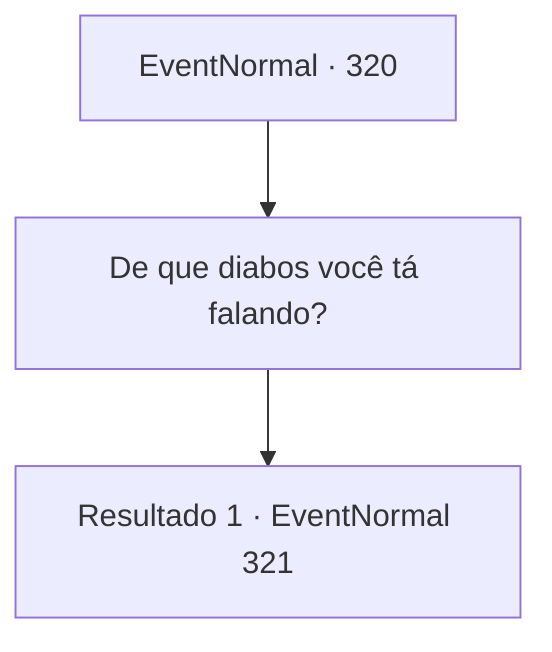

# Eventos normais · 320

[Índice da tabela](index.md) · [Índice geral](../index.md)

ID: `pt:EventNormal:320` · Fonte: `EventNormal4` · Versão: 1.2.47.

Mapeamento estático dos arquivos; a disponibilidade e a execução dependem do estado da run.

## Texto do evento

*Sem texto no arquivo.*

## Dados de entrada

```json
{
  "id": 320,
  "grade": 1,
  "place": "",
  "required": ""
}
```

## Mapa das escolhas



## Escolhas e resultados

### Escolha 1

De que diabos você tá falando?

Requisitos e outros campos da escolha:

```json
{
  "required": ""
}
```

#### Resultado 1.1

Você pergunta o que ele fez, e com um suspiro profundo ele vira seu olhar para a garota dentro do círculo mágico. 

 "Meu nome é Grran. A garota aqui é minha filha, e ela pegou algum tipo de doença terrível... então eu procurei maneiras de curá-la."

 Ele toca o círculo mágico no chão e continua. 

 "É isso. Puxando a força vital dos habitantes da cidade e infundindo-a na minha filha. Isso dará a ela pelo menos 10 anos de vida."

 Ele se aproxima lentamente de você e agarra seu ombro. Com os olhos vermelhos de sangue, ele olha para você e continua. <color=red>

 "Por favor, por favor... esqueça o que está acontecendo aqui. Só desta vez. Uma vez é o suficiente."

</color>

Continuação registrada: [Evento 321](0321.md) na mesma tabela.

```json
{
  "required": "",
  "chance": "1",
  "nextEvent": 321,
  "type": 2,
  "reward": ""
}
```

## Referências que chegam a este evento

- [Evento 319 · escolha 1 · resultado 1](0319.md#escolha-1)
