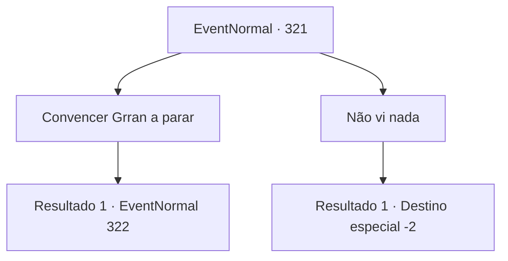

# Eventos normais · 321

[Índice da tabela](index.md) · [Índice geral](../index.md)

ID: `pt:EventNormal:321` · Fonte: `EventNormal4` · Versão: 1.2.47.

Mapeamento estático dos arquivos; a disponibilidade e a execução dependem do estado da run.

## Texto do evento

*Sem texto no arquivo.*

## Dados de entrada

```json
{
  "id": 321,
  "grade": 1,
  "place": "",
  "required": ""
}
```

## Mapa das escolhas



## Escolhas e resultados

### Escolha 1

Convencer Grran a parar

Requisitos e outros campos da escolha:

```json
{
  "required": ""
}
```

#### Resultado 1.1

Você simplesmente não consegue ignorar as ações dele. Ele se levanta do banco com um olhar triste no rosto. 

 "É assim que vai ser... minha filha é a coisa mais importante da minha vida."

 Ele avança até você, emitindo uma aura maligna.

Continuação registrada: [Evento 322](0322.md) na mesma tabela.

```json
{
  "required": "",
  "chance": "1",
  "nextEvent": 322,
  "type": 2,
  "reward": "6_0_115",
  "place": 4
}
```

### Escolha 2

Não vi nada

Requisitos e outros campos da escolha:

```json
{
  "required": ""
}
```

#### Resultado 2.1

Você aceita a proposta dele e sai de casa. 

 "...Obrigado. Pegue isso."

 Ele vasculha a casa e lhe entrega um precioso pingente. Você o pega e fecha a porta. Você corre para fora da cidade, o cheiro de sangue ainda está forte no ar.

Continuação registrada: [Destino especial `-2`](../destinos-especiais.md).

```json
{
  "required": "",
  "chance": "1",
  "nextEvent": -2,
  "type": 2,
  "reward": "5_221_9|3_71_1"
}
```

## Referências que chegam a este evento

- [Evento 320 · escolha 1 · resultado 1](0320.md#escolha-1)
