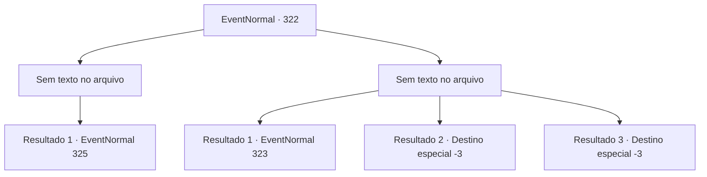

# Eventos normais · 322

[Índice da tabela](index.md) · [Índice geral](../index.md)

ID: `pt:EventNormal:322` · Fonte: `EventNormal4` · Versão: 1.2.47.

Mapeamento estático dos arquivos; a disponibilidade e a execução dependem do estado da run.

## Texto do evento

*Sem texto no arquivo.*

## Dados de entrada

```json
{
  "id": 322,
  "grade": 1,
  "place": "",
  "required": ""
}
```

## Mapa das escolhas



## Escolhas e resultados

### Escolha 1

*Sem texto no arquivo; o papel dessa opção depende da interface do jogo.*

Requisitos e outros campos da escolha:

```json
{
  "required": ""
}
```

#### Resultado 1.1

Você o derrota depois de uma batalha intensa. A força vital começa a retornar aos legítimos donos e a filha de Grran desaparece. Grran rasteja no chão, cuspindo sangue. 

 "Por quê?!! Por que... Oh por que?!"

 Grran segura sua filha mais perto, que agora não é nada mais que um saco frio de ossos. E então, ele solta seu último suspiro. À sua frente estão dois corpos frios e sem vida.

Continuação registrada: [Evento 325](0325.md) na mesma tabela.

```json
{
  "required": "",
  "chance": "1",
  "nextEvent": 325,
  "type": 2,
  "reward": ""
}
```

### Escolha 2

*Sem texto no arquivo; o papel dessa opção depende da interface do jogo.*

Requisitos e outros campos da escolha:

```json
{
  "required": ""
}
```

#### Resultado 2.1

Você tenta parar Grran, mas ele te impede para salvar sua filha. Enquanto você respira pesadamente, o círculo mágico começa a emitir luz. Grran rapidamente se aproxima de sua filha. 

 "...Papai?"

 A filha de Grran procura calmamente pelo pai, como se tivesse acabado de acordar de um sono. Ele abraça a criança com força, explodindo em lágrimas. A garotinha fica assustada sem saber o que está acontecendo.

Continuação registrada: [Evento 323](0323.md) na mesma tabela.

```json
{
  "required": "1_0_2|1_1_2",
  "chance": "1",
  "nextEvent": 323,
  "type": 2,
  "reward": "0_0_-1|0_1_-1|5_221_9"
}
```

#### Resultado 2.2

Você não consegue derrotar o pai que está tentando proteger sua filha. Sua maldição fria também entra em seu corpo. Você espuma e cai.

Continuação registrada: [Destino especial `-3`](../destinos-especiais.md).

```json
{
  "required": "2_0_2",
  "chance": "1",
  "nextEvent": -3,
  "type": 2,
  "reward": "0_0_-1|0_1_-1"
}
```

#### Resultado 2.3

Você não consegue derrotar o pai que está tentando proteger sua filha. Sua maldição fria também entra em seu corpo. Você espuma e cai.

Continuação registrada: [Destino especial `-3`](../destinos-especiais.md).

```json
{
  "required": "2_1_2",
  "chance": "1",
  "nextEvent": -3,
  "type": 2,
  "reward": "0_0_-1|0_1_-1"
}
```

## Referências que chegam a este evento

- [Evento 321 · escolha 1 · resultado 1](0321.md#escolha-1)
