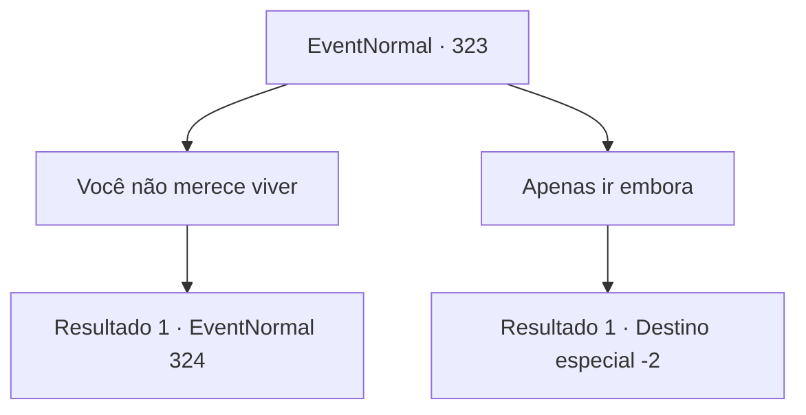

# Eventos normais · 323

[Índice da tabela](index.md) · [Índice geral](../index.md)

ID: `pt:EventNormal:323` · Fonte: `EventNormal4` · Versão: 1.2.47.

Mapeamento estático dos arquivos; a disponibilidade e a execução dependem do estado da run.

## Texto do evento

*Sem texto no arquivo.*

## Dados de entrada

```json
{
  "id": 323,
  "grade": 1,
  "place": "",
  "required": ""
}
```

## Mapa das escolhas



## Escolhas e resultados

### Escolha 1

Você não merece viver

Requisitos e outros campos da escolha:

```json
{
  "required": ""
}
```

#### Resultado 1.1

Você julga que essas pessoas não merecem viver. Então você saca sua arma contra Grran mais uma vez.

Continuação registrada: [Evento 324](0324.md) na mesma tabela.

```json
{
  "required": "",
  "chance": "1",
  "nextEvent": 324,
  "type": 2,
  "reward": "6_2_115",
  "place": 4
}
```

### Escolha 2

Apenas ir embora

Requisitos e outros campos da escolha:

```json
{
  "required": ""
}
```

#### Resultado 2.1

Você deixa a casa e a família que agora está reunida. Por fim, você sai da cidade sangrenta.

Continuação registrada: [Destino especial `-2`](../destinos-especiais.md).

```json
{
  "required": "",
  "chance": "1",
  "nextEvent": -2,
  "type": 2,
  "reward": "5_221_9"
}
```

## Referências que chegam a este evento

- [Evento 322 · escolha 2 · resultado 1](0322.md#escolha-2)
