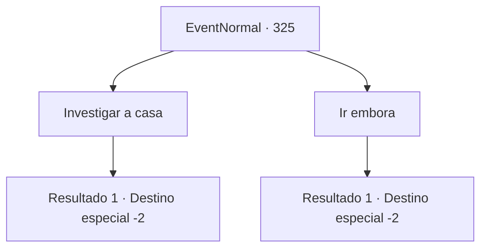

# Eventos normais · 325

[Índice da tabela](index.md) · [Índice geral](../index.md)

ID: `pt:EventNormal:325` · Fonte: `EventNormal4` · Versão: 1.2.47.

Mapeamento estático dos arquivos; a disponibilidade e a execução dependem do estado da run.

## Texto do evento

*Sem texto no arquivo.*

## Dados de entrada

```json
{
  "id": 325,
  "grade": 1,
  "place": "",
  "required": ""
}
```

## Mapa das escolhas



## Escolhas e resultados

### Escolha 1

Investigar a casa

Requisitos e outros campos da escolha:

```json
{
  "required": ""
}
```

#### Resultado 1.1

Não há nada peculiar na pequena cabana de madeira. Apenas algumas ervas estranhas. Você saqueia o corpo sem vida de Grran. adquirindo uma pequena quantidade de ouro e seu pingente. Você deixa os dois cadáveres e sai da casa.

Continuação registrada: [Destino especial `-2`](../destinos-especiais.md).

```json
{
  "required": "",
  "chance": "1",
  "nextEvent": -2,
  "type": 2,
  "reward": "5_221_9|3_71_1|0_3_-1|0_4_50"
}
```

### Escolha 2

Ir embora

Requisitos e outros campos da escolha:

```json
{
  "required": ""
}
```

#### Resultado 2.1

Você deixa os dois cadáveres e sai da casa. Em seguida, você deixa a cidade sangrenta.

Continuação registrada: [Destino especial `-2`](../destinos-especiais.md).

```json
{
  "required": "",
  "chance": "1",
  "nextEvent": -2,
  "type": 2,
  "reward": "5_221_9"
}
```

## Referências que chegam a este evento

- [Evento 322 · escolha 1 · resultado 1](0322.md#escolha-1)
- [Evento 324 · escolha 1 · resultado 1](0324.md#escolha-1)
