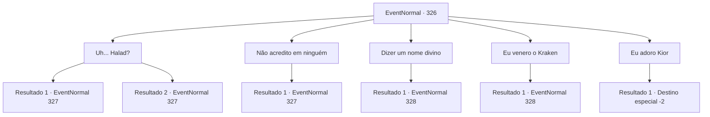

# Eventos normais · 326

[Índice da tabela](index.md) · [Índice geral](../index.md)

ID: `pt:EventNormal:326` · Fonte: `EventNormal4` · Versão: 1.2.47.

Mapeamento estático dos arquivos; a disponibilidade e a execução dependem do estado da run.

## Texto do evento

Você chega a uma pequena cidade. |drawing_fam| As pessoas aqui estão murmurando algo com os olhos vazios. Quando você se aproxima deles para ouvir com mais atenção, eles dizem 'O Grande Halad é o único divino.' Um deles se aproxima de você e pergunta. 

 "Em que... divino... você acredita?"

 Ele questiona você, desprovido de toda e qualquer emoção em seu rosto. Ele está usando um chapéu de palha velho e roupas esfarrapadas, segurando um ancinho nas mãos. Quando os olhos dele encontram os seus, você descobre que eles estão vazios como um poço seco.

## Dados de entrada

```json
{
  "id": 326,
  "grade": 1,
  "place": "",
  "required": "18_216_1|5_223_0"
}
```

## Mapa das escolhas



## Escolhas e resultados

### Escolha 1

Uh... Halad?

Requisitos e outros campos da escolha:

```json
{
  "required": ""
}
```

#### Resultado 1.1

Ele ouve sua resposta, seu rosto ainda está em branco. Então ele responde com uma voz mais uma vez em branco. 

 "Companheiro fiel das terras exteriores. Venha... aqui..."

 Ele cambaleia à frente, sinalizando para você o seguir. Você o segue até uma igreja, coberta de trepadeiras. A igreja está cheia de aldeões, que estão orando inexpressivamente como os que estão afora. A igreja emite uma vibração sinistra. O homem que te trouxe até aqui se senta e te encara. 

 "Nós... vamos orar agora. Grande Halad... é o único... ser divino..."


Continuação registrada: [Evento 327](0327.md) na mesma tabela.

```json
{
  "required": "11_0_0",
  "chance": "1",
  "nextEvent": 327,
  "type": 2,
  "reward": "5_223_1"
}
```

#### Resultado 1.2

Ele ouve sua resposta, seu rosto ainda em branco. Então ele responde com uma voz mais uma vez em branco. 

 "Companheiro fiel das terras exteriores. Aqui... vem..."

 Ele cambaleia à frente, sinalizando para você seguir. Você o segue até uma igreja, coberta de trepadeiras. A igreja está cheia de aldeões, que estão orando inexpressivamente como os que estão afora. A igreja emite uma vibração sinistra. O homem que te trouxe até aqui se senta e te encara. 

 "Nós... vamos orar agora. Grande Halad... é o único... divino..."


Continuação registrada: [Evento 327](0327.md) na mesma tabela.

```json
{
  "required": "11_0_1",
  "chance": "1",
  "nextEvent": 327,
  "type": 2,
  "reward": "5_223_1"
}
```

### Escolha 2

Não acredito em ninguém

Requisitos e outros campos da escolha:

```json
{
  "required": ""
}
```

#### Resultado 2.1

Ele ouve sua resposta, seu rosto ainda em branco. Então ele responde com uma voz mais uma vez em branco. 

 "Companheiro fiel das terras exteriores. Aqui... vem..."

 Ele cambaleia à frente, sinalizando para você seguir. Você o segue até uma igreja, coberta de trepadeiras. A igreja está cheia de aldeões, que estão orando inexpressivamente como os que estão afora. A igreja emite uma vibração sinistra. O homem que te trouxe até aqui se senta e te encara. 

 "Nós... vamos orar agora. Grande Halad... é o único... divino..."


Continuação registrada: [Evento 327](0327.md) na mesma tabela.

```json
{
  "required": "",
  "chance": "1",
  "nextEvent": 327,
  "type": 2,
  "reward": "5_223_1"
}
```

### Escolha 3

Dizer um nome divino

Requisitos e outros campos da escolha:

```json
{
  "required": ""
}
```

#### Resultado 3.1

Ele ouve sua resposta, seu rosto ainda em branco. Então ele responde com uma voz mais uma vez em branco. 

 "Esse é um deus falso! Não acredite em algo que não existe. Adore... Halad... agora."

 Assim que ele termina, ele agarra seu ancinho e vai pra cima de você.

Continuação registrada: [Evento 328](0328.md) na mesma tabela.

```json
{
  "required": "",
  "chance": "1",
  "nextEvent": 328,
  "type": 2,
  "reward": "6_0_116|5_223_1",
  "place": 4
}
```

### Escolha 4

Eu venero o Kraken

Requisitos e outros campos da escolha:

```json
{
  "required": "5_222_1"
}
```

#### Resultado 4.1

Ele ouve sua resposta, seu rosto ainda em branco. Então ele responde com uma voz mais uma vez em branco. 

 "Aquele... nunca será um verdadeiro divino... Adore... Halad... agora."

 Assim que ele termina, ele agarra seu ancinho e vai pra cima de você.

Continuação registrada: [Evento 328](0328.md) na mesma tabela.

```json
{
  "required": "",
  "chance": "1",
  "nextEvent": 328,
  "type": 2,
  "reward": "6_0_116|5_223_1",
  "place": 4
}
```

### Escolha 5

Eu adoro Kior

Requisitos e outros campos da escolha:

```json
{
  "required": "5_432_1|18_431_1"
}
```

#### Resultado 5.1

Ele ouve sua resposta, seu rosto ainda sem expressão. Então ele responde com uma voz novamente vazia. 

 "...O..kay."

 Assim que ele terminou de falar, o homem virou-se e saiu.

Continuação registrada: [Destino especial `-2`](../destinos-especiais.md).

```json
{
  "required": "",
  "chance": "1",
  "nextEvent": -2,
  "type": 2,
  "reward": "5_223_9"
}
```

## Referências que chegam a este evento

Nenhum `nextEvent` positivo da mesma tabela aponta para este nó. Isso não prova que seja inacessível: sorteio e estado de história podem selecioná-lo.

