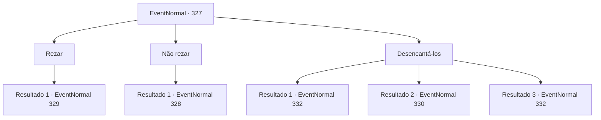

# Eventos normais · 327

[Índice da tabela](index.md) · [Índice geral](../index.md)

ID: `pt:EventNormal:327` · Fonte: `EventNormal4` · Versão: 1.2.47.

Mapeamento estático dos arquivos; a disponibilidade e a execução dependem do estado da run.

## Texto do evento

*Sem texto no arquivo.*

## Dados de entrada

```json
{
  "id": 327,
  "grade": 1,
  "place": "",
  "required": ""
}
```

## Mapa das escolhas



## Escolhas e resultados

### Escolha 1

Rezar

Requisitos e outros campos da escolha:

```json
{
  "required": ""
}
```

#### Resultado 1.1

Você faz o seu melhor para se encaixar e começa a repetir a oração depois dele. O homem que o trouxe aqui olha para você sem emoção, e somente depois que você termina sua oração ele desvia o olhar de você, fechando os olhos. 

 "Apenas... Halad..."

 Ele começa a murmurar sua própria oração assim como os outros. E parece que ele vai ficar lá por um bom tempo. Você se levanta, para se despedir. Porém um padre vestindo uma túnica vermelha aparece de repente diante de você. 

 "Bem-vindo. Seja batizado e renasça como um verdadeiro fiel."

 Ele tenta chegar perto de sua cabeça com suas mãos, estas que possuem símbolos estranhos.

Continuação registrada: [Evento 329](0329.md) na mesma tabela.

```json
{
  "required": "",
  "chance": "1",
  "nextEvent": 329,
  "type": 2,
  "reward": ""
}
```

### Escolha 2

Não rezar

Requisitos e outros campos da escolha:

```json
{
  "required": ""
}
```

#### Resultado 2.1

Você se recusa a rezar. Então, o homem de antes, sem emoção agarra seu ancinho. 

 "Recusar... não é uma opção... Morte... ao herege!!"

 Ele move os braços e balança o ancinho, como uma marionete controlada por cordas.

Continuação registrada: [Evento 328](0328.md) na mesma tabela.

```json
{
  "required": "",
  "chance": "1",
  "nextEvent": 328,
  "type": 2,
  "reward": "6_0_116",
  "place": 4
}
```

### Escolha 3

Desencantá-los

Requisitos e outros campos da escolha:

```json
{
  "required": "1_14_10|20_0_1"
}
```

#### Resultado 3.1

Você percebe que essas pessoas estão sob a influência de algum feitiço, e as liberta do encantamento. Depois que a magia vai embora, os olhos das pessoas começam a brilhar com luz novamente. 

 "O-o que? O que estou fazendo aqui...?"

 Alguns começam a tocar seus próprios corpos, se beliscando no rosto, e alguns até começam a cair no chão como marionetes sem cordas. Então, um padre vestindo uma túnica vermelha sai de uma sala dentro da igreja. 

 "Ah..! Quem está aí?! Quem ousa interromper o ritual sagrado...?!"

 Ele olha em volta e te vê. Por fim, ele percebe que você é o responsável por isso. 

 "NÃO INTERROMPA A GRANDE Halad!!"

 Ele tira uma adaga de seus bolsos e anda em sua direção.

Continuação registrada: [Evento 332](0332.md) na mesma tabela.

```json
{
  "required": "21_0_3",
  "chance": "1|0_7_1",
  "nextEvent": 332,
  "type": 0,
  "reward": "6_0_71",
  "place": 4
}
```

#### Resultado 3.2

Você percebe que essas pessoas estão sob a influência de algum feitiço, e tenta libertá-las do encantamento. Mas o feitiço é muito complicado para você. Sua tentativa sai pela culatra, mexendo com sua cabeça. Você faz o seu melhor para se levantar. Então, um sacerdote vestindo uma túnica vermelha fala em voz baixa. 

 "Seu insolente...!"

 Ele tira uma adaga de seus bolsos e a aponta para você.

Continuação registrada: [Evento 330](0330.md) na mesma tabela.

```json
{
  "required": "21_0_3",
  "chance": "13",
  "nextEvent": 330,
  "type": 1,
  "reward": "6_0_71",
  "place": 4
}
```

#### Resultado 3.3

Você percebe que essas pessoas estão sob a influência de algum feitiço, e as liberta do encantamento. Depois que a magia acaba, os olhos das pessoas começam a brilhar com luz novamente. 

 "O-o que? O que estou fazendo aqui...?"

 Alguns começam a tocar seus próprios corpos, se beliscando no rosto, e alguns até começam a cair no chão como marionetes sem cordas. Então, um padre vestindo uma túnica vermelha sai de uma sala dentro da igreja. 

 "Ah..! Quem está aí?! Quem ousa interromper o ritual sagrado...?!"

 Ele olha em volta e te vê. Então, ele percebe que você é o responsável por isso. 

 "NÃO INTERROMPA A GRANDE Halad!!"

 Ele tira uma adaga de seus bolsos e começa vir em sua direção. 

Continuação registrada: [Evento 332](0332.md) na mesma tabela.

```json
{
  "required": "20_0_3",
  "chance": "1",
  "nextEvent": 332,
  "type": 2,
  "reward": "6_0_71",
  "place": 4
}
```

## Referências que chegam a este evento

- [Evento 326 · escolha 1 · resultado 1](0326.md#escolha-1)
- [Evento 326 · escolha 1 · resultado 2](0326.md#escolha-1)
- [Evento 326 · escolha 2 · resultado 1](0326.md#escolha-2)
