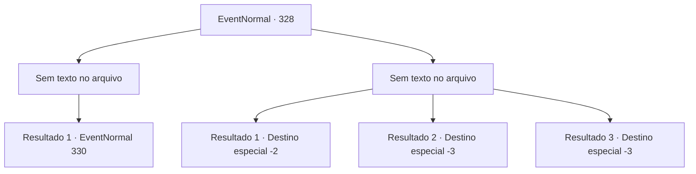

# Eventos normais · 328

[Índice da tabela](index.md) · [Índice geral](../index.md)

ID: `pt:EventNormal:328` · Fonte: `EventNormal4` · Versão: 1.2.47.

Mapeamento estático dos arquivos; a disponibilidade e a execução dependem do estado da run.

## Texto do evento

*Sem texto no arquivo.*

## Dados de entrada

```json
{
  "id": 328,
  "grade": 1,
  "place": "",
  "required": ""
}
```

## Mapa das escolhas



## Escolhas e resultados

### Escolha 1

*Sem texto no arquivo; o papel dessa opção depende da interface do jogo.*

Requisitos e outros campos da escolha:

```json
{
  "required": ""
}
```

#### Resultado 1.1


 "Ur... Ugh... Droga..."

 Você bate bastante no homem e ele rola no chão. Em seguida, um padre vestindo uma túnica vermelha aparece. Ele olha para o homem caído e para você, e então grita com hostilidade. 

 "Seu insolente...!"

 Ele tira uma adaga dos bolsos e te ataca.

Continuação registrada: [Evento 330](0330.md) na mesma tabela.

```json
{
  "required": "",
  "chance": "1",
  "nextEvent": 330,
  "type": 2,
  "reward": "6_0_71|5_224_1",
  "place": 4
}
```

### Escolha 2

*Sem texto no arquivo; o papel dessa opção depende da interface do jogo.*

Requisitos e outros campos da escolha:

```json
{
  "required": ""
}
```

#### Resultado 2.1

Rapidamente você foge do homem do ancinho. Ele tenta vir atrás de você, mas cai e isso lhe dá tempo suficiente para escapar da cidade.

Continuação registrada: [Destino especial `-2`](../destinos-especiais.md).

```json
{
  "required": "1_0_2|1_1_2",
  "chance": "1",
  "nextEvent": -2,
  "type": 2,
  "reward": "0_0_-1|0_1_-1|5_223_2"
}
```

#### Resultado 2.2

Você fica inconsciente depois de ser atingido na cabeça pelo ancinho.

Continuação registrada: [Destino especial `-3`](../destinos-especiais.md).

```json
{
  "required": "2_0_2",
  "chance": "1",
  "nextEvent": -3,
  "type": 2,
  "reward": "0_0_-1|0_1_-1"
}
```

#### Resultado 2.3

Você fica inconsciente depois de ser atingido na cabeça pelo ancinho.

Continuação registrada: [Destino especial `-3`](../destinos-especiais.md).

```json
{
  "required": "2_1_2",
  "chance": "1",
  "nextEvent": -3,
  "type": 2,
  "reward": "0_0_-1|0_1_-1"
}
```

## Referências que chegam a este evento

- [Evento 326 · escolha 3 · resultado 1](0326.md#escolha-3)
- [Evento 326 · escolha 4 · resultado 1](0326.md#escolha-4)
- [Evento 327 · escolha 2 · resultado 1](0327.md#escolha-2)
