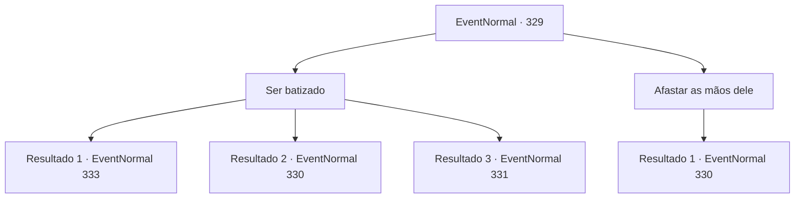

# Eventos normais · 329

[Índice da tabela](index.md) · [Índice geral](../index.md)

ID: `pt:EventNormal:329` · Fonte: `EventNormal4` · Versão: 1.2.47.

Mapeamento estático dos arquivos; a disponibilidade e a execução dependem do estado da run.

## Texto do evento

*Sem texto no arquivo.*

## Dados de entrada

```json
{
  "id": 329,
  "grade": 1,
  "place": "",
  "required": ""
}
```

## Mapa das escolhas



## Escolhas e resultados

### Escolha 1

Ser batizado

Requisitos e outros campos da escolha:

```json
{
  "required": ""
}
```

#### Resultado 1.1

Você calmamente espera pelo batizado. Uma força branca fumegante sai de suas mãos e sorve em sua cabeça. Você se sente estranho enquanto a neblina mexe com seu cérebro, e seus olhos escurecem com a escuridão.

Continuação registrada: [Evento 333](0333.md) na mesma tabela.

```json
{
  "required": "",
  "chance": "1",
  "nextEvent": 333,
  "type": 2,
  "reward": ""
}
```

#### Resultado 1.2

Você calmamente espera pelo batizado. Uma força branca fumegante sai de suas mãos e sorve em sua cabeça. Mas a neblina não consegue penetrar em você completamente e se dissipa no ar. O padre afasta as mãos e franze a testa. 

 "Hmm... Que pena. Você não é necessário aqui."

 Com uma mudança repentina de comportamento, ele tira uma adaga de seus bolsos.

Continuação registrada: [Evento 330](0330.md) na mesma tabela.

```json
{
  "required": "23_7_1",
  "chance": "1",
  "nextEvent": 330,
  "type": 2,
  "reward": "6_0_71",
  "place": 4
}
```

#### Resultado 1.3

Você calmamente espera pelo batizado. Uma força branca fumegante sai de suas mãos e sorve em sua cabeça. Mas a neblina não consegue penetrar em você completamente e se dissipa no ar. O padre solta um grito e puxa as mãos para trás. Seu braço se transforma em algo que parece um tentáculo de polvo, e então explode. 

 "Ur... AAAAAH!!!"

 Tendo perdido o braço direito, o padre espuma e desmaia. Isso retorna a vida aos olhos das pessoas da cidade. 

 "O-o que? O que estou fazendo aqui...?"

 Alguns começam a tocar seus próprios corpos, se beliscando no rosto, e alguns até começam a cair no chão como marionetes sem cordas. O homem que o guiou até a igreja vem e fala com você. 

 "O que foi que aconteceu?"

 

Continuação registrada: [Evento 331](0331.md) na mesma tabela.

```json
{
  "required": "5_222_1",
  "chance": "1",
  "nextEvent": 331,
  "type": 2,
  "reward": ""
}
```

### Escolha 2

Afastar as mãos dele

Requisitos e outros campos da escolha:

```json
{
  "required": ""
}
```

#### Resultado 2.1

Você dá um tapa nas mãos do padre. Ele puxa as mãos para trás, franzindo a testa. 

 "Hmm... Que pena. Você não é necessário aqui."

 Com uma mudança repentina de comportamento, ele tira uma adaga de seus bolsos.

Continuação registrada: [Evento 330](0330.md) na mesma tabela.

```json
{
  "required": "",
  "chance": "1",
  "nextEvent": 330,
  "type": 2,
  "reward": "6_0_71",
  "place": 4
}
```

## Referências que chegam a este evento

- [Evento 327 · escolha 1 · resultado 1](0327.md#escolha-1)
