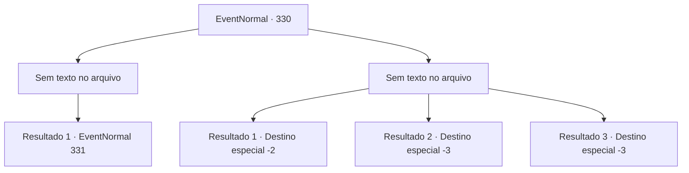

# Eventos normais · 330

[Índice da tabela](index.md) · [Índice geral](../index.md)

ID: `pt:EventNormal:330` · Fonte: `EventNormal4` · Versão: 1.2.47.

Mapeamento estático dos arquivos; a disponibilidade e a execução dependem do estado da run.

## Texto do evento

*Sem texto no arquivo.*

## Dados de entrada

```json
{
  "id": 330,
  "grade": 1,
  "place": "",
  "required": ""
}
```

## Mapa das escolhas



## Escolhas e resultados

### Escolha 1

*Sem texto no arquivo; o papel dessa opção depende da interface do jogo.*

Requisitos e outros campos da escolha:

```json
{
  "required": ""
}
```

#### Resultado 1.1

O padre vestido de vermelho avança até você, mas é derrotado. Quando ele desmaia, a vida volta aos olhos das pessoas da cidade. 

 "O-o que? O que estou fazendo aqui...?"

 Alguns começam a tocar seus próprios corpos, se beliscando no rosto, e alguns até começam a cair no chão como marionetes sem cordas. O homem que o guiou até a igreja vem e fala com você. 

 "O que foi que aconteceu?"

 

Continuação registrada: [Evento 331](0331.md) na mesma tabela.

```json
{
  "required": "",
  "chance": "1",
  "nextEvent": 331,
  "type": 2,
  "reward": ""
}
```

### Escolha 2

*Sem texto no arquivo; o papel dessa opção depende da interface do jogo.*

Requisitos e outros campos da escolha:

```json
{
  "required": ""
}
```

#### Resultado 2.1

Você consegue escapar do padre de túnica vermelha. Ele corre por um bom tempo, mas não rápido o suficiente para alcançá-lo.

Continuação registrada: [Destino especial `-2`](../destinos-especiais.md).

```json
{
  "required": "1_0_2|1_1_2",
  "chance": "1",
  "nextEvent": -2,
  "type": 2,
  "reward": "5_223_9|0_0_-1|0_1_-1"
}
```

#### Resultado 2.2

O padre de túnica vermelha se aproxima de você, que está deitado no chão. Ele então se abaixa e continua. 

 "Tudo pelo Grande Halad."

 Depois de terminar, ele enfia a adaga em seu peito.

Continuação registrada: [Destino especial `-3`](../destinos-especiais.md).

```json
{
  "required": "2_0_2",
  "chance": "1",
  "nextEvent": -3,
  "type": 2,
  "reward": "0_0_-1|0_1_-1"
}
```

#### Resultado 2.3

O padre de túnica vermelha se aproxima de você, que está deitado no chão. Ele então se abaixa e continua. 

 "Tudo pela Grande Halad."

 Depois de terminar, ele enfia a adaga em seu peito.

Continuação registrada: [Destino especial `-3`](../destinos-especiais.md).

```json
{
  "required": "2_1_2",
  "chance": "1",
  "nextEvent": -3,
  "type": 2,
  "reward": "0_0_-1|0_1_-1"
}
```

## Referências que chegam a este evento

- [Evento 327 · escolha 3 · resultado 2](0327.md#escolha-3)
- [Evento 328 · escolha 1 · resultado 1](0328.md#escolha-1)
- [Evento 329 · escolha 1 · resultado 2](0329.md#escolha-1)
- [Evento 329 · escolha 2 · resultado 1](0329.md#escolha-2)
