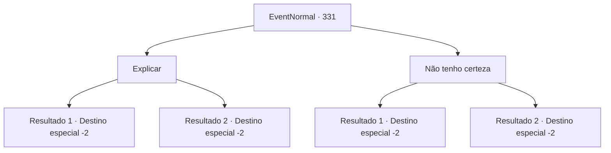

# Eventos normais · 331

[Índice da tabela](index.md) · [Índice geral](../index.md)

ID: `pt:EventNormal:331` · Fonte: `EventNormal4` · Versão: 1.2.47.

Mapeamento estático dos arquivos; a disponibilidade e a execução dependem do estado da run.

## Texto do evento

*Sem texto no arquivo.*

## Dados de entrada

```json
{
  "id": 331,
  "grade": 1,
  "place": "",
  "required": ""
}
```

## Mapa das escolhas



## Escolhas e resultados

### Escolha 1

Explicar

Requisitos e outros campos da escolha:

```json
{
  "required": ""
}
```

#### Resultado 1.1

Você diz a eles que eles sofreram lavagem cerebral e que você os libertou do feitiço. Depois de ouvir sua explicação, ele aperta suas mãos e fala. 

 "Obrigado. Agora entendo porque estou com tanta fome. Aparentemente eu tenho orado até a exaustão. Venha para minha casa. Eu gostaria de convidá-lo para uma refeição, assim posso mostrar meu agradecimento."

 Você o segue até sua velha casa surrada. Ele parece estar morando sozinho, o que parece ter feito dele um bom cozinheiro. Ele apresenta-lhe um guisado com uma diversidade de legumes e um pouco de carne. Parece que ele está ganhando a vida com isso. Você devora o ensopado e sai da casa dele.

Continuação registrada: [Destino especial `-2`](../destinos-especiais.md).

```json
{
  "required": "18_224_1",
  "chance": "1",
  "nextEvent": -2,
  "type": 2,
  "reward": "0_0_1|0_1_1|5_223_9"
}
```

#### Resultado 1.2

Você diz a eles que eles sofreram lavagem cerebral e que você os libertou do feitiço. Depois de ouvir sua explicação, ele aperta suas mãos e fala. 

 "Obrigado. Eu gostaria que você tivesse feito isso de uma maneira mais agradável, mas o que importa é que você salvou minha vida. Venha para minha casa. Eu gostaria de convidá-lo para uma refeição, assim posso mostrar meu apreço."

 Você o segue até sua velha casa surrada. Ele parece estar morando sozinho, o que parece ter feito dele um bom cozinheiro. Ele apresenta-lhe um guisado com uma diversidade de legumes e um pouco de carne. Parece que ele está ganhando a vida com isso. Você devora o ensopado e sai da casa dele.

Continuação registrada: [Destino especial `-2`](../destinos-especiais.md).

```json
{
  "required": "5_224_1",
  "chance": "1",
  "nextEvent": -2,
  "type": 2,
  "reward": "0_0_1|0_1_1|5_223_9"
}
```

### Escolha 2

Não tenho certeza

Requisitos e outros campos da escolha:

```json
{
  "required": ""
}
```

#### Resultado 2.1

Você sai da cidade sem explicar o que aconteceu.

Continuação registrada: [Destino especial `-2`](../destinos-especiais.md).

```json
{
  "required": "18_224_1",
  "chance": "1",
  "nextEvent": -2,
  "type": 2,
  "reward": "5_223_9"
}
```

#### Resultado 2.2

Você sai da cidade sem explicar o que aconteceu. O homem que você libertou inclina a cabeça em confusão, olhando para suas costas enquanto você se afasta.

Continuação registrada: [Destino especial `-2`](../destinos-especiais.md).

```json
{
  "required": "5_224_1",
  "chance": "1",
  "nextEvent": -2,
  "type": 2,
  "reward": "5_223_9"
}
```

## Referências que chegam a este evento

- [Evento 329 · escolha 1 · resultado 3](0329.md#escolha-1)
- [Evento 330 · escolha 1 · resultado 1](0330.md#escolha-1)
- [Evento 332 · escolha 1 · resultado 1](0332.md#escolha-1)
- [Evento 332 · escolha 2 · resultado 1](0332.md#escolha-2)
