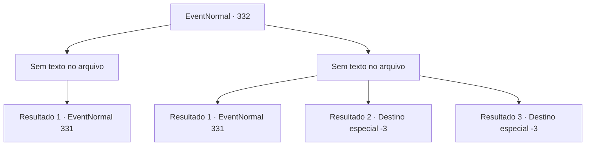

# Eventos normais · 332

[Índice da tabela](index.md) · [Índice geral](../index.md)

ID: `pt:EventNormal:332` · Fonte: `EventNormal4` · Versão: 1.2.47.

Mapeamento estático dos arquivos; a disponibilidade e a execução dependem do estado da run.

## Texto do evento

*Sem texto no arquivo.*

## Dados de entrada

```json
{
  "id": 332,
  "grade": 1,
  "place": "",
  "required": ""
}
```

## Mapa das escolhas



## Escolhas e resultados

### Escolha 1

*Sem texto no arquivo; o papel dessa opção depende da interface do jogo.*

Requisitos e outros campos da escolha:

```json
{
  "required": ""
}
```

#### Resultado 1.1

O padre de túnica vermelha ataca você, mas perde. Ele chama por 'Halad', dando seu último suspiro. Mas aparentemente seu grito desesperado não chega aos ouvidos de Halad. O homem que o guiou até a igreja vem e fala com você. 

 "O que acabou de acontecer?"


Continuação registrada: [Evento 331](0331.md) na mesma tabela.

```json
{
  "required": "",
  "chance": "1",
  "nextEvent": 331,
  "type": 2,
  "reward": ""
}
```

### Escolha 2

*Sem texto no arquivo; o papel dessa opção depende da interface do jogo.*

Requisitos e outros campos da escolha:

```json
{
  "required": ""
}
```

#### Resultado 2.1

Assim que a lâmina do padre chega perto de sua garganta, ele cai no chão de repente. Você vê o homem que o guiou até a igreja atrás dele, segurando um porrete de madeira. 

 "Eu... achei que deveria te ajudar. Esse padre parecia meio perigoso."

 Ele tenta o seu melhor para explicar sua ação, e então pergunta a você. 

 "Enfim, o que aconteceu?"


Continuação registrada: [Evento 331](0331.md) na mesma tabela.

```json
{
  "required": "1_0_2|1_1_2",
  "chance": "1",
  "nextEvent": 331,
  "type": 2,
  "reward": "0_0_-1|0_1_-1"
}
```

#### Resultado 2.2

O padre de túnica vermelha se aproxima de você, que está deitado no chão. Ele então se abaixa e continua. 

 "Tudo pela Grande Halad."

 Depois de terminar, ele enfia a adaga em seu peito.

Continuação registrada: [Destino especial `-3`](../destinos-especiais.md).

```json
{
  "required": "2_0_2",
  "chance": "1",
  "nextEvent": -3,
  "type": 2,
  "reward": "0_0_-1|0_1_-1"
}
```

#### Resultado 2.3

O padre de túnica vermelha se aproxima de você, que está deitado no chão. Ele então se abaixa e continua. 

 "Tudo pela Grande Halad."

 Depois de terminar, ele enfia a adaga em seu peito.

Continuação registrada: [Destino especial `-3`](../destinos-especiais.md).

```json
{
  "required": "2_1_2",
  "chance": "1",
  "nextEvent": -3,
  "type": 2,
  "reward": "0_0_-1|0_1_-1"
}
```

## Referências que chegam a este evento

- [Evento 327 · escolha 3 · resultado 1](0327.md#escolha-3)
- [Evento 327 · escolha 3 · resultado 3](0327.md#escolha-3)
