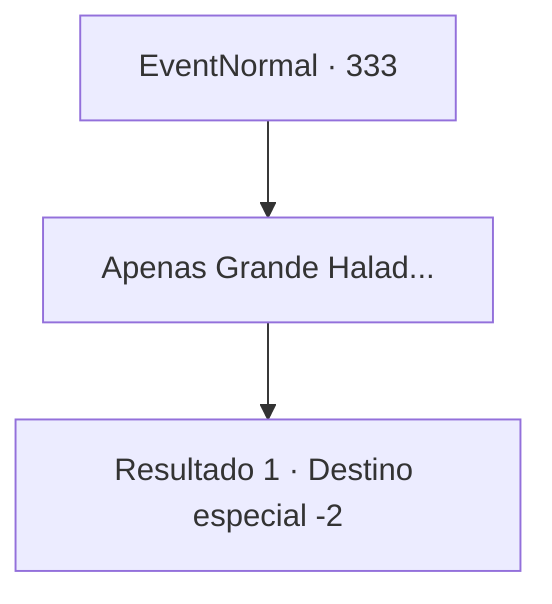

# Eventos normais · 333

[Índice da tabela](index.md) · [Índice geral](../index.md)

ID: `pt:EventNormal:333` · Fonte: `EventNormal4` · Versão: 1.2.47.

Mapeamento estático dos arquivos; a disponibilidade e a execução dependem do estado da run.

## Texto do evento

*Sem texto no arquivo.*

## Dados de entrada

```json
{
  "id": 333,
  "grade": 1,
  "place": "",
  "required": ""
}
```

## Mapa das escolhas



## Escolhas e resultados

### Escolha 1

Apenas Grande Halad...

Requisitos e outros campos da escolha:

```json
{
  "required": ""
}
```

#### Resultado 1.1

Na escuridão, você só ouve uma voz cantando repetidamente 'Grande Halad é o único divino'. Depois de algum tempo você percebe que a voz é sua. Mas você simplesmente não pode impedi-la de sair. Depois de algum tempo novamente, sua mente de repente clareia e você recupera a visão. Parece que você está orando em frente a uma cachoeira. Você não sabe há quanto tempo está fazendo isso, mas pela dor eletrizante nas pernas, você sente que já faz um bom tempo. 

 Você massageia suas pernas por um longo tempo, finalmente recuperando a capacidade de andar novamente, com sua mente limpa da voz adorando Halad.

Continuação registrada: [Destino especial `-2`](../destinos-especiais.md).

```json
{
  "required": "",
  "chance": "1",
  "nextEvent": -2,
  "type": 2,
  "reward": "5_223_3|0_7_-1|0_14_-1"
}
```

## Referências que chegam a este evento

- [Evento 329 · escolha 1 · resultado 1](0329.md#escolha-1)
