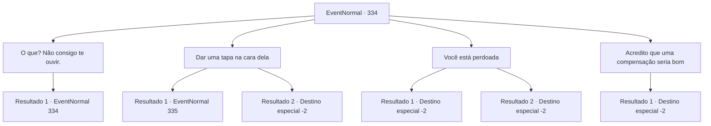

# Eventos normais · 334

[Índice da tabela](index.md) · [Índice geral](../index.md)

ID: `pt:EventNormal:334` · Fonte: `EventNormal4` · Versão: 1.2.47.

Mapeamento estático dos arquivos; a disponibilidade e a execução dependem do estado da run.

## Texto do evento

Você está caminhando por um pradaria verde, com uma grama tão alta que quase chega até os joelhos. O sol forte se projeta sobre sua cabeça como cortinas e, de repente, algo bloqueia a luz. Quando você olha para cima, um portal se abre e uma dupla de mago e maga aparecem diante de você. O assistente é o primeiro a falar e cumprimentá-lo. 

 "Saudações, {1} Eu sou um mago da Torre da Magia, 'Selemin'. E essa aqui é a..."

 A bruxa ao lado dele inclina a cabeça e cumprimenta você. Enquanto Selemin cutuca seu corpo, ela caminha lentamente até você e se ajoelha. 

 "Eu... Meu nome é Halad... Eu vim para... me desculpar. Você deve ter estar bem machucado por minha causa..."

 Ela se apresenta e se desculpa com uma voz quase inaudível. Você lembra o nome dela das pessoas da cidade que enlouqueceram. Era esse nome que o padre de manto vermelho ficava repetindo mesmo quando estava encharcado de fome e exaustão. O nome que você gritou continuamente, quando sua consciência foi tomada pela escuridão do ritual.

## Dados de entrada

```json
{
  "id": 334,
  "grade": 2,
  "place": "",
  "required": "5_223_3|1_2_65"
}
```

## Mapa das escolhas



## Escolhas e resultados

### Escolha 1

O que? Não consigo te ouvir.

Requisitos e outros campos da escolha:

```json
{
  "required": "5_225_0"
}
```

#### Resultado 1.1

Você diz sarcasticamente que não consegue ouvir o que ela está dizendo. Halad, com a voz trêmula, fala mais alto. <link=shake>

 "Sinto muito! Tudo isso só por causa da minha sede de poder... Lamento ter feito você passar por tudo isso...!"

</link>

Continuação registrada: [Evento 334](0334.md) na mesma tabela.

```json
{
  "required": "",
  "chance": "1",
  "nextEvent": 334,
  "type": 2,
  "reward": "5_225_1"
}
```

### Escolha 2

Dar uma tapa na cara dela

Requisitos e outros campos da escolha:

```json
{
  "required": "2_3_0"
}
```

#### Resultado 2.1

Você dá um tapa na bochecha de Halad com toda a sua força. Com um 'tapa' afiado, sua cabeça se inclina levemente e volta lentamente para onde estava. Selemin cruza os braços e fica olhando silenciosamente enquanto a cena se desenrola. Os ombros de Halad tremem levemente. Então ela se levanta, olha para você e fala. 

 "Eu... eu não aguento toda essa humilhação...!"

 Quando ela abre as palmas das mãos, um círculo mágico é imediatamente moldado, e bolas de fogo começam a ser jogadas em você.

Continuação registrada: [Evento 335](0335.md) na mesma tabela.

```json
{
  "required": "2_5_20",
  "chance": "1",
  "nextEvent": 335,
  "type": 2,
  "reward": "6_2_79",
  "place": 0
}
```

#### Resultado 2.2

Você dá um tapa na bochecha de Halad com toda a sua força. Com um som 'TA-PA', sua cabeça se inclina. Então ela cai no chão. Selemin se assusta quando ele se aproxima dela. 

 "Huh..! Halad!! O que... eu entendo que você está bravo, mas você está passando dos limites!"

 Com um pequeno gesto, ele abre o portal e leva Halad embora. Você estica os pulsos e se sente satisfeito.

Continuação registrada: [Destino especial `-2`](../destinos-especiais.md).

```json
{
  "required": "1_5_20",
  "chance": "1",
  "nextEvent": -2,
  "type": 2,
  "reward": "5_223_9|0_1_1"
}
```

### Escolha 3

Você está perdoada

Requisitos e outros campos da escolha:

```json
{
  "required": "1_3_0"
}
```

#### Resultado 3.1

Embora você ainda não se sinta completamente bem, você decide aceitar o pedido de desculpas dela. 

 "...Obrigada."

 Sua expressão parece sem emoção e desajeitada, como se ela não tivesse certeza de que rosto fazer em uma situação como essa. Selemin se aproxima de você, passando por Halad. 

 "Você é um bom homem. Aceitar as desculpas dela tão rápido... é surpreendente, na verdade. Agora, não há como isso ser uma compensação suficiente..."

 Depois de parar brevemente, Selemin estende a mão no ar e puxa uma pequena bolsa, entregando-a a você. Ele então abre um portal com um pequeno gesto de mão e se despede. 

 "Adeus então. Que seus caminhos levem a areias quentes."

 Os dois magos desaparecem no portal, e logo o portal também.

Continuação registrada: [Destino especial `-2`](../destinos-especiais.md).

```json
{
  "required": "2_3_15",
  "chance": "1",
  "nextEvent": -2,
  "type": 2,
  "reward": "3_100_1|5_223_9|0_3_1|0_4_50"
}
```

#### Resultado 3.2

Você decide aceitar o pedido de desculpas dela de coração. Como sinal de perdão, você a abraça calorosamente, e ela abraça você também, embora com um olhar confuso no rosto. 

 "Obrigada... por me perdoar."

 Ela ainda olha para você com descrença e ela parece não estar ciente das lágrimas que descem de seus olhos. Selemin se aproxima de você, passando por Halad. 

 "Você é um bom homem. Aceitar as desculpas dela tão rápido... é surpreendente, na verdade. Agora, não há como isso ser uma compensação suficiente..."

 Depois de parar brevemente, Selemin estende a mão no ar e puxa uma pequena bolsa, entregando-a a você. Ele então abre um portal com um pequeno gesto de mão e se despede. 

 "Adeus então. Que seus caminhos levem a areias quentes."

 Os dois magos desaparecem no portal, e logo o portal também.

Continuação registrada: [Destino especial `-2`](../destinos-especiais.md).

```json
{
  "required": "1_3_15",
  "chance": "1",
  "nextEvent": -2,
  "type": 2,
  "reward": "3_100_1|5_223_9|0_1_1|0_3_1|0_4_50"
}
```

### Escolha 4

Acredito que uma compensação seria bom

Requisitos e outros campos da escolha:

```json
{
  "required": ""
}
```

#### Resultado 4.1

Você gira o polegar e o dedo indicador em um círculo. Percebendo o que você quis dizer, Selemin acena e responde. 

 "Entendi."

 Ele alcança o ar, puxando uma pequena bolsa e entregando a você. Ele então sussurra algo nos ouvidos de Halad. Enquanto você verifica o que está dentro da bolsa, Halad pede desculpas a você novamente. 

 "Lamento profundamente. Só espero que isso compense o que fiz com você. Adeus."

 Ela abre o portal com um pequeno gesto de mão, e os dois magos desaparecem no portal. Você coloca a bolsa cheia de ouro em sua mochila.

Continuação registrada: [Destino especial `-2`](../destinos-especiais.md).

```json
{
  "required": "",
  "chance": "1",
  "nextEvent": -2,
  "type": 2,
  "reward": "0_4_150|5_223_9"
}
```

## Referências que chegam a este evento

- [Evento 334 · escolha 1 · resultado 1](0334.md#escolha-1)
