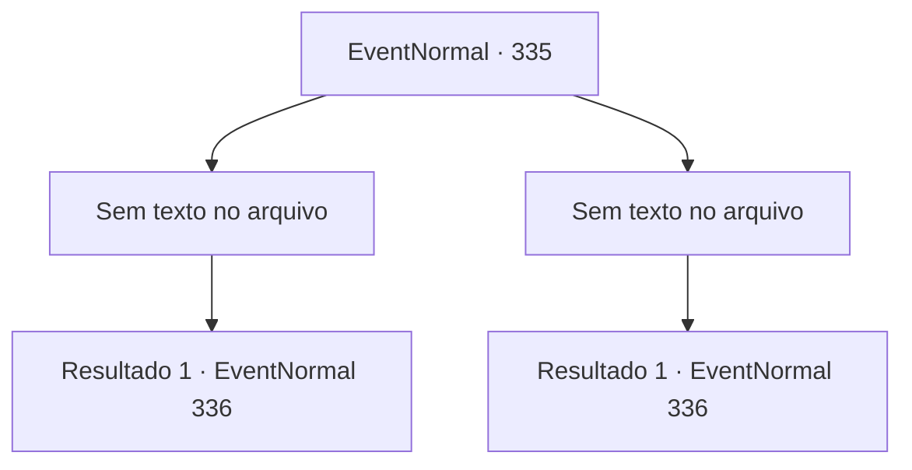

# Eventos normais · 335

[Índice da tabela](index.md) · [Índice geral](../index.md)

ID: `pt:EventNormal:335` · Fonte: `EventNormal4` · Versão: 1.2.47.

Mapeamento estático dos arquivos; a disponibilidade e a execução dependem do estado da run.

## Texto do evento

*Sem texto no arquivo.*

## Dados de entrada

```json
{
  "id": 335,
  "grade": 1,
  "place": "",
  "required": ""
}
```

## Mapa das escolhas



## Escolhas e resultados

### Escolha 1

*Sem texto no arquivo; o papel dessa opção depende da interface do jogo.*

Requisitos e outros campos da escolha:

```json
{
  "required": ""
}
```

#### Resultado 1.1

Enquanto você está lutando contra Halad, Selemin intervém. Ele separa você de Halad, agarra os ombros dela e fala. 

 "Ei, ei... Espere. Espere. Você está aqui para se desculpar, isso só vai piorar as coisas. Lembra o que eu disse? Se alguém bater em você em uma bochecha?"

 "...volta para ele o outro também. Mas isso era para ser uma metáfora!"

 Depois de uma breve conversa, eles voltam para você. Halad se ajoelha para você novamente, e pede desculpas pelo que ela fez, e também por agredir você. 

 "*suspiro*.... Me desculpe. Se me bater faz você se sentir melhor... faça isso."


Continuação registrada: [Evento 336](0336.md) na mesma tabela.

```json
{
  "required": "",
  "chance": "1",
  "nextEvent": 336,
  "type": 2,
  "reward": ""
}
```

### Escolha 2

*Sem texto no arquivo; o papel dessa opção depende da interface do jogo.*

Requisitos e outros campos da escolha:

```json
{
  "required": ""
}
```

#### Resultado 2.1

Enquanto você está lutando contra Halad, Selemin intervém. Ele separa você de Halad, agarra os ombros dela e fala. 

 "Ei, ei... Espere. Espere. Você está aqui para se desculpar, isso só vai piorar as coisas. Lembra o que eu disse? Se alguém bater em você em uma bochecha?"

 "...volta para ele o outro também. Mas isso era para ser uma metáfora!"

 Depois de uma breve conversa, eles voltam para você. Halad se ajoelha para você novamente, e pede desculpas pelo que ela fez, e também por agredir você. 

 "*suspiro*.... Me desculpe. Se me bater faz você se sentir melhor... faça isso."


Continuação registrada: [Evento 336](0336.md) na mesma tabela.

```json
{
  "required": "",
  "chance": "1",
  "nextEvent": 336,
  "type": 2,
  "reward": ""
}
```

## Referências que chegam a este evento

- [Evento 334 · escolha 2 · resultado 1](0334.md#escolha-2)
