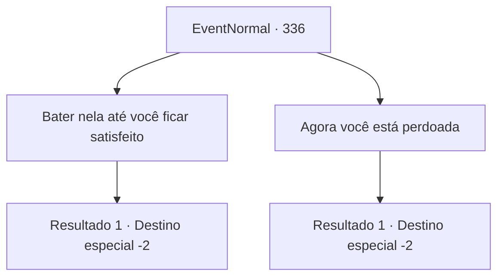

# Eventos normais · 336

[Índice da tabela](index.md) · [Índice geral](../index.md)

ID: `pt:EventNormal:336` · Fonte: `EventNormal4` · Versão: 1.2.47.

Mapeamento estático dos arquivos; a disponibilidade e a execução dependem do estado da run.

## Texto do evento

*Sem texto no arquivo.*

## Dados de entrada

```json
{
  "id": 336,
  "grade": 1,
  "place": "",
  "required": ""
}
```

## Mapa das escolhas



## Escolhas e resultados

### Escolha 1

Bater nela até você ficar satisfeito

Requisitos e outros campos da escolha:

```json
{
  "required": "2_3_-14"
}
```

#### Resultado 1.1

Você prepara sua mão e dá um tapa nela de novo. Você continua a esbofeteá-la para a esquerda e para a direita, inúmeras vezes, e somente quando você é pego pela respiração, sua batida para. As bochechas da bruxa estão inchadas e vermelhas, e sangue escorre de seus lábios. Enquanto você prepara sua mão novamente, Selemin se aproxima silenciosamente. 

 "Agora... estaremos a caminho."

 Ele abre um portal com um pequeno gesto de mão, pegando Halad, sentando sem emoção no chão e saindo. Você solta um longo suspiro, e seus pulsos doem de tanto bater. Depois de esticar os pulsos por um tempo, você pega sua bolsa novamente.

Continuação registrada: [Destino especial `-2`](../destinos-especiais.md).

```json
{
  "required": "",
  "chance": "1",
  "nextEvent": -2,
  "type": 2,
  "reward": "0_3_-2|5_223_9|0_1_1"
}
```

### Escolha 2

Agora você está perdoada

Requisitos e outros campos da escolha:

```json
{
  "required": ""
}
```

#### Resultado 2.1

Você dá uma olhada no rosto da bruxa. Suas bochechas estão inchadas e vermelhas, e lágrimas cobrem seus olhos. Você sente que é o suficiente e decide perdoá-la finalmente. Selemin, de pé ao seu lado e observando a cena se desenrolar, responde. 

 "Então... vou assumir que você a perdoou. Vamos nos despedir, então."

 Ele abre um portal com um pequeno gesto de mão, pega Halad que está ajoelhado no chão e sai.

Continuação registrada: [Destino especial `-2`](../destinos-especiais.md).

```json
{
  "required": "",
  "chance": "1",
  "nextEvent": -2,
  "type": 2,
  "reward": "5_223_9|0_1_1"
}
```

## Referências que chegam a este evento

- [Evento 335 · escolha 1 · resultado 1](0335.md#escolha-1)
- [Evento 335 · escolha 2 · resultado 1](0335.md#escolha-2)
