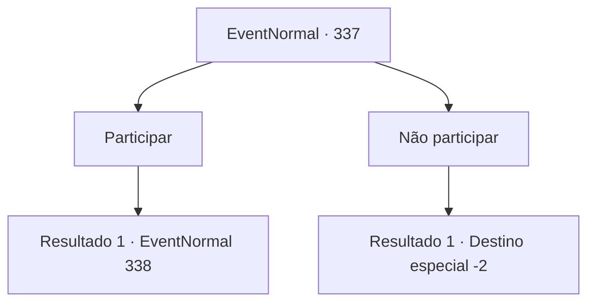

# Eventos normais · 337

[Índice da tabela](index.md) · [Índice geral](../index.md)

ID: `pt:EventNormal:337` · Fonte: `EventNormal4` · Versão: 1.2.47.

Mapeamento estático dos arquivos; a disponibilidade e a execução dependem do estado da run.

## Texto do evento

Você vê uma enorme multidão de pessoas em frente à entrada da cidade. Conforme você se move pela multidão murmurante, você vê um soldado usando armadura, instalando uma mesa temporária e colocando um pôster no quadro de avisos. 

 'Precisa-se de força de trabalho para transporte de suprimentos para a expansão de assentamentos fronteiriços' |drawing_board| Depois de instalar tudo o que é necessário, o soldado se vira para a multidão e fala. 

 "Ouçam, esta é uma operação de abastecimento crucial para o próximo acordo do programa de fronteira do reino. Espera-se que todos os homens saudáveis ​​se inscrevam."


## Dados de entrada

```json
{
  "id": 337,
  "grade": 1,
  "place": "",
  "required": "18_215_1|5_226_0|2_2_20"
}
```

## Mapa das escolhas



## Escolhas e resultados

### Escolha 1

Participar

Requisitos e outros campos da escolha:

```json
{
  "required": ""
}
```

#### Resultado 1.1

Você empurra a multidão e consegue chamar a atenção do soldado. 

 "Escreva seu nome, idade e cidade natal aqui."

 Depois de escrever rapidamente as informações necessárias em um pedaço de papel, você o devolve ao soldado. Ele verifica e depois o envia para o local onde outras pessoas para a operação estão esperando. Depois de alguns minutos, o soldado leva o grupo de voluntários para sua tropa, guarnecida na esquina da cidade. Depois de conversar brevemente com o soldado, um homem vestido com roupas extravagantes se aproxima de você e dos voluntários e grita com uma voz digna. 

 "Bem conhecido, homens. Eu sou o Conde Jimradi, o administrador designado desta operação. Vamos fazer o nosso melhor para não falhar."

 Após terminar, Jimradi entra em seu vagão e não aparece mais. Logo, uma carroça de madeira cheia de suprimentos e tropas que a escolta começa a seguir em direção ao seu destino. Seu trabalho é carregar os suprimentos que não foram colocados no carrinho.

Continuação registrada: [Evento 338](0338.md) na mesma tabela.

```json
{
  "required": "",
  "chance": "1",
  "nextEvent": 338,
  "type": 2,
  "reward": "5_226_9"
}
```

### Escolha 2

Não participar

Requisitos e outros campos da escolha:

```json
{
  "required": ""
}
```

#### Resultado 2.1

Você ignora o cartaz e vai embora.

Continuação registrada: [Destino especial `-2`](../destinos-especiais.md).

```json
{
  "required": "",
  "chance": "1",
  "nextEvent": -2,
  "type": 2,
  "reward": "5_226_9"
}
```

## Referências que chegam a este evento

Nenhum `nextEvent` positivo da mesma tabela aponta para este nó. Isso não prova que seja inacessível: sorteio e estado de história podem selecioná-lo.

