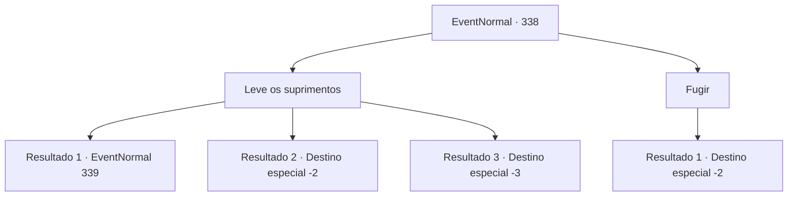

# Eventos normais · 338

[Índice da tabela](index.md) · [Índice geral](../index.md)

ID: `pt:EventNormal:338` · Fonte: `EventNormal4` · Versão: 1.2.47.

Mapeamento estático dos arquivos; a disponibilidade e a execução dependem do estado da run.

## Texto do evento

*Sem texto no arquivo.*

## Dados de entrada

```json
{
  "id": 338,
  "grade": 1,
  "place": "",
  "required": ""
}
```

## Mapa das escolhas



## Escolhas e resultados

### Escolha 1

Leve os suprimentos

Requisitos e outros campos da escolha:

```json
{
  "required": ""
}
```

#### Resultado 1.1

Você pega o saco de suprimentos. É um trabalho árduo, ter que andar horas sem pausa carregando coisas pesadas. Mas para você, treinado por aventuras, não é uma tarefa difícil. A marcha continua por dias. Depois de caminhar, caminhar e caminhar, uma semana se passa. 

 "Pare! Categorize os suprimentos e armazene-os aqui!"

 Você leva os suprimentos para o prédio de armazenamento localizado perto do assentamento da fronteira e segue as ordens do soldado colocando-os nos locais corretos. Você está finalmente livre do trabalho, mas o pagamento que você recebe é de 10 ouros insignificantes.

Continuação registrada: [Evento 339](0339.md) na mesma tabela.

```json
{
  "required": "",
  "chance": "1|0_13_1",
  "nextEvent": 339,
  "type": 0,
  "reward": "0_4_10"
}
```

#### Resultado 1.2

Você pega o saco de suprimentos. É um trabalho árduo, ter que andar horas sem pausa carregando coisas pesadas, e a exaustão finalmente vence. Mas os soldados se preocupam mais com os suprimentos do que você, então eles forçam outro a carregar seus suprimentos, expulsando você da marcha.

Continuação registrada: [Destino especial `-2`](../destinos-especiais.md).

```json
{
  "required": "1_0_2",
  "chance": "10",
  "nextEvent": -2,
  "type": 1,
  "reward": "0_0_-1"
}
```

#### Resultado 1.3

Você decide obedecer às ordens deles. Mas a cansativa marcha continua por uma semana e, infelizmente, você desmaia. Mas os soldados se preocupam mais com os suprimentos do que com você. Você morre uma morte solitária, em meio à indiferença deles.

Continuação registrada: [Destino especial `-3`](../destinos-especiais.md).

```json
{
  "required": "2_0_2",
  "chance": "10",
  "nextEvent": -3,
  "type": 1,
  "reward": "0_0_-1"
}
```

### Escolha 2

Fugir

Requisitos e outros campos da escolha:

```json
{
  "required": ""
}
```

#### Resultado 2.1

Você não pode ficar andando por horas, carregando suprimentos pesados. Infelizmente, cerca de três horas depois que o grupo partiu da cidade, você escolhe um soldado que não parece tão inteligente durante o intervalo. Você diz a ele que vai fazer xixi e foge assim.

Continuação registrada: [Destino especial `-2`](../destinos-especiais.md).

```json
{
  "required": "",
  "chance": "1",
  "nextEvent": -2,
  "type": 2,
  "reward": ""
}
```

## Referências que chegam a este evento

- [Evento 337 · escolha 1 · resultado 1](0337.md#escolha-1)
