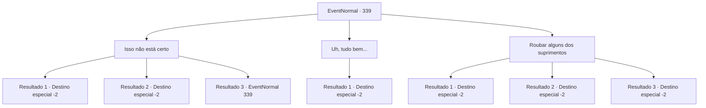

# Eventos normais · 339

[Índice da tabela](index.md) · [Índice geral](../index.md)

ID: `pt:EventNormal:339` · Fonte: `EventNormal4` · Versão: 1.2.47.

Mapeamento estático dos arquivos; a disponibilidade e a execução dependem do estado da run.

## Texto do evento

*Sem texto no arquivo.*

## Dados de entrada

```json
{
  "id": 339,
  "grade": 1,
  "place": "",
  "required": ""
}
```

## Mapa das escolhas



## Escolhas e resultados

### Escolha 1

Isso não está certo

Requisitos e outros campos da escolha:

```json
{
  "required": "5_227_0"
}
```

#### Resultado 1.1

Você diz com raiva que a recompensa é muito pequena. Os soldados respondem, embora de maneira cuidadosa. 

 "Vamos lá, você está servindo ao seu país. A quantidade de recompensa é realmente... tão importante?"

 Os soldados dizem que não podem distribuir recompensas maiores, e os voluntários que compartilham seu pensamento o apoiam, literal e figurativamente. Então, alguém que você não viu desde que a operação começou aparece. É o Conde Jimradi, mãos atrás das costas. 

 "Qual é o alvoroço?"

 Você diz a ele que a recompensa que recebeu não corresponde à quantidade de trabalho realizado. O Conde Jimradi responde, atônito. 

 "Hum... sim, sobre isso..."

 Você pega o conde hesitante pelo pescoço, olhando-o nos olhos. Ele tenta evitar seus olhos, gritando. 

 "Bem bem! Se isso é realmente o que você sente, eu vou te pagar pessoalmente!!"

 Finalmente o conde concorda em pagar mais aos voluntários, e todos agradecem. 

Continuação registrada: [Destino especial `-2`](../destinos-especiais.md).

```json
{
  "required": "",
  "chance": "1|0_12_1",
  "nextEvent": -2,
  "type": 0,
  "reward": "0_2_1|0_4_50"
}
```

#### Resultado 1.2

Você diz com raiva que a recompensa é muito pequena, com seu rosto simbólico de bandido e vibração mortal. Os soldados respondem, embora de maneira cuidadosa. 

 "Vamos lá... é tudo pelo país..."

 Os soldados dizem que não podem distribuir recompensas maiores, e os voluntários que compartilham seu pensamento o apoiam, literal e figurativamente. Então, alguém que você não viu desde que a operação começou aparece. É o Conde Jimradi, mãos atrás das costas. 

 "Qual é o alvoroço?"

 Você diz a ele que a recompensa que recebeu não corresponde à quantidade de trabalho realizado. O Conde Jimradi responde, atônito. 

 "Hum... sim, sobre isso..."

 Você pega o conde hesitante pelo pescoço, olhando-o nos olhos. Ele tenta evitar seus olhos, gritando. 

 "Bem bem! Se isso é realmente o que você sente, eu vou te pagar pessoalmente!!"

 Finalmente o conde concorda em pagar mais aos voluntários, e todos agradecem. 

Continuação registrada: [Destino especial `-2`](../destinos-especiais.md).

```json
{
  "required": "20_1_2",
  "chance": "1|0_12_1",
  "nextEvent": -2,
  "type": 0,
  "reward": "0_2_1|0_4_50"
}
```

#### Resultado 1.3

Você diz com raiva que a recompensa é muito pequena. Mas os soldados não te ouvem e estão tão zangados quanto você. 

 "O QUE! Você está servindo seu país ao concluir esta operação, a recompensa realmente importa?!"

 Os soldados gritam com você, e aqueles que compartilham seu pensamento o apoiam, literal e figurativamente. Então, alguém que você não viu desde que a operação começou aparece. É o Conde Jimradi, mãos atrás das costas. 

 "Qual é o alvoroço?"

 Você diz a ele que a recompensa que recebeu não corresponde à quantidade de trabalho realizado. O Conde Jimradi balança a cabeça. Você sente pena em seu rosto. 

 "Eu sinto muito. As circunstâncias são terríveis, você deve entender."

    

Continuação registrada: [Evento 339](0339.md) na mesma tabela.

```json
{
  "required": "",
  "chance": "12",
  "nextEvent": 339,
  "type": 1,
  "reward": "5_227_1"
}
```

### Escolha 2

Uh, tudo bem...

Requisitos e outros campos da escolha:

```json
{
  "required": ""
}
```

#### Resultado 2.1

Você acredita que o dinheiro da recompensa é muito pequeno, mas decide apenas jogar com ele. Alguns voluntários gritam que a recompensa é muito pequena, mas os soldados não ouvem, dizendo que é para o melhor do país. Você olha para o armazenamento cheio de suprimentos antes de ir embora.

Continuação registrada: [Destino especial `-2`](../destinos-especiais.md).

```json
{
  "required": "",
  "chance": "1",
  "nextEvent": -2,
  "type": 2,
  "reward": ""
}
```

### Escolha 3

Roubar alguns dos suprimentos

Requisitos e outros campos da escolha:

```json
{
  "required": ""
}
```

#### Resultado 3.1

Para receber a 'quantidade justa' de recompensa, você decide roubar alguns dos suprimentos. Depois de entrar cuidadosamente no depósito quando ninguém está olhando, você pega uma espada e uma armadura bonitas e foge.

Continuação registrada: [Destino especial `-2`](../destinos-especiais.md).

```json
{
  "required": "",
  "chance": "1|0_6_1",
  "nextEvent": -2,
  "type": 0,
  "reward": "3_33_1|3_14_1|0_3_-1"
}
```

#### Resultado 3.2

Para receber a 'quantidade justa' de recompensa, você decide roubar alguns dos suprimentos. Mas ao entrar cuidadosamente no depósito, você é encontrado por um soldado. 

 "Você aí! O que você está fazendo!!"

 Seu grito chama os soldados próximos à sua localização, e você não tem escolha a não ser fugir.

Continuação registrada: [Destino especial `-2`](../destinos-especiais.md).

```json
{
  "required": "",
  "chance": "10",
  "nextEvent": -2,
  "type": 1,
  "reward": ""
}
```

#### Resultado 3.3

Para receber a 'quantidade justa' de recompensa, você decide roubar alguns dos suprimentos. Mas ao entrar cuidadosamente no depósito, você é encontrado por um soldado. 

 "Você aí! O que você está fazendo!!"

 Seu grito chama os soldados próximos à sua localização, e você não tem escolha a não ser fugir.

Continuação registrada: [Destino especial `-2`](../destinos-especiais.md).

```json
{
  "required": "21_5_0",
  "chance": "20",
  "nextEvent": -2,
  "type": 1,
  "reward": ""
}
```

## Referências que chegam a este evento

- [Evento 338 · escolha 1 · resultado 1](0338.md#escolha-1)
- [Evento 339 · escolha 1 · resultado 3](0339.md#escolha-1)
