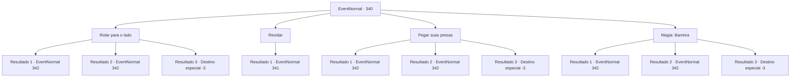

# Eventos normais · 340

[Índice da tabela](index.md) · [Índice geral](../index.md)

ID: `pt:EventNormal:340` · Fonte: `EventNormal4` · Versão: 1.2.47.

Mapeamento estático dos arquivos; a disponibilidade e a execução dependem do estado da run.

## Texto do evento

Você está andando por uma floresta exuberante, decorada com árvores gigantes. Então, um enorme javali vem guinchando de um arbusto próximo, respirando pesadamente. É um javali, com presas gigantes. <link=shake>

 "GROOOOWWL!!!"

</link> Antes que você possa fazer qualquer coisa, o javali avança até você. Ele está furioso, seu corpo está cheio de flechas e cicatrizes.

## Dados de entrada

```json
{
  "id": 340,
  "grade": 2,
  "place": "",
  "required": "18_215_1|5_226_0|1_2_50"
}
```

## Mapa das escolhas



## Escolhas e resultados

### Escolha 1

Rolar para o lado

Requisitos e outros campos da escolha:

```json
{
  "required": ""
}
```

#### Resultado 1.1

O javali avança aonde você estava anteriormente, enquanto você se esquiva com manobras rápidas. Ele vira o corpo para você, emitindo um rosnado monstruoso, mas uma flecha logo voa em sua cabeça. O javali desmorona com um baque. Alguém graciosamente pula no chão, do topo de uma árvore próxima. 

 "Esta floresta é um território dos elfos. É perigoso para os humanos. Você deveria ir para outro lugar."

 A mulher com um laço nas costas dá um aviso, mas ela mesma parece humana.

Continuação registrada: [Evento 342](0342.md) na mesma tabela.

```json
{
  "required": "",
  "chance": "1|0_6_1",
  "nextEvent": 342,
  "type": 0,
  "reward": "0_2_1"
}
```

#### Resultado 1.2

Você não consegue se esquivar do javali, sendo abalroado e jogado no ar. Ele passa por você e vira o corpo, emitindo um rosnado monstruoso, mas uma flecha logo voa em sua cabeça. O javali desmorona com um baque. Alguém graciosamente pula no chão, do topo de uma árvore próxima. 

 "Esta floresta é um território dos elfos. É perigoso para os humanos. Você deveria ir para outro lugar."

 A mulher com um laço nas costas dá um aviso, mas ela mesma parece humana.

Continuação registrada: [Evento 342](0342.md) na mesma tabela.

```json
{
  "required": "1_0_2",
  "chance": "12",
  "nextEvent": 342,
  "type": 1,
  "reward": "0_0_-1"
}
```

#### Resultado 1.3

Você não consegue se esquivar do javali, sendo abalroado e jogado no ar. Ossos quebrados perfuram seus pulmões e você perde a consciência ao dar seu último suspiro.

Continuação registrada: [Destino especial `-3`](../destinos-especiais.md).

```json
{
  "required": "2_0_2",
  "chance": "12",
  "nextEvent": -3,
  "type": 1,
  "reward": "0_0_-1"
}
```

### Escolha 2

Revidar

Requisitos e outros campos da escolha:

```json
{
  "required": ""
}
```

#### Resultado 2.1

Você prepara sua arma e contra-ataca.

Continuação registrada: [Evento 341](0341.md) na mesma tabela.

```json
{
  "required": "",
  "chance": "1",
  "nextEvent": 341,
  "type": 2,
  "reward": "6_2_46",
  "place": 1
}
```

### Escolha 3

Pegar suas presas

Requisitos e outros campos da escolha:

```json
{
  "required": ""
}
```

#### Resultado 3.1

Você pega as presas do javali de barbear. O javali gigante parece surpreso. Aparentemente, algo assim nunca aconteceu antes. Você exibe uma força incrível, quebrando suas presas estridentes, e o javali grita de dor. <link=shake>

 "GRITO!!! SQUUEEAALL!!"

</link> Então, uma flecha voa na cabeça do javali. O javali desmorona com um baque. Alguém graciosamente pula no chão, do topo de uma árvore próxima. 

 "Esta floresta é um território dos elfos. É perigoso para os humanos. Você deveria ir para outro lugar."

 A mulher com um laço nas costas dá um aviso, mas ela mesma parece humana.

Continuação registrada: [Evento 342](0342.md) na mesma tabela.

```json
{
  "required": "",
  "chance": "1|0_5_1",
  "nextEvent": 342,
  "type": 0,
  "reward": "0_2_1"
}
```

#### Resultado 3.2

Você tenta agarrar as presas do javali, mas sem sucesso. Suas presas batem em você, jogando você no ar. Ele passa por você e vira o corpo, emitindo um rosnado monstruoso, mas uma flecha logo voa em sua cabeça. O javali desmorona com um baque. Alguém graciosamente pula no chão, do topo de uma árvore próxima. 

 "Esta floresta é um território dos elfos. É perigoso para os humanos. Você deveria ir para outro lugar."

 A mulher com um laço nas costas dá um aviso, mas ela mesma parece humana.

Continuação registrada: [Evento 342](0342.md) na mesma tabela.

```json
{
  "required": "1_0_2",
  "chance": "15",
  "nextEvent": 342,
  "type": 1,
  "reward": "0_0_-1"
}
```

#### Resultado 3.3

Você tenta agarrar as presas do javali, mas sem sucesso. Suas presas batem em você, jogando você no ar. Você cai de volta no chão, e ossos quebrados perfuram seus pulmões. Você perde a consciência ao dar seu último suspiro.

Continuação registrada: [Destino especial `-3`](../destinos-especiais.md).

```json
{
  "required": "2_0_2",
  "chance": "15",
  "nextEvent": -3,
  "type": 1,
  "reward": "0_0_-1"
}
```

### Escolha 4

Magia: Barreira

Requisitos e outros campos da escolha:

```json
{
  "required": "20_0_2|1_1_2"
}
```

#### Resultado 4.1

Você não entra em pânico e lança um feitiço. Depois de bater em uma barreira invisível, o javali grita de dor. <link=shake>

 "GRITO!!! SQUUEEAALL!!"

</link> Então, uma flecha voa na cabeça do javali. O javali desmorona com um baque. Alguém graciosamente pula no chão, do topo de uma árvore próxima. 

 "Esta floresta é um território dos elfos. É perigoso para os humanos. Você deveria ir para outro lugar."

 A mulher com um laço nas costas dá um aviso, mas ela mesma parece humana.

Continuação registrada: [Evento 342](0342.md) na mesma tabela.

```json
{
  "required": "",
  "chance": "1|0_14_1",
  "nextEvent": 342,
  "type": 0,
  "reward": "0_2_1|0_1_-1"
}
```

#### Resultado 4.2

Você entra em pânico e não consegue lançar um feitiço. Infelizmente, você não consegue se esquivar do javali quando ele bate em você e o joga no ar. Ele passa por você e vira o corpo, emitindo um rosnado monstruoso, mas uma flecha logo voa em sua cabeça. O javali desmorona com um baque. Alguém graciosamente pula no chão, do topo de uma árvore próxima. 

 "Esta floresta é um território dos elfos. É perigoso para os humanos. Você deveria ir para outro lugar."

 A mulher com um laço nas costas dá um aviso, mas ela mesma parece humana. 

Continuação registrada: [Evento 342](0342.md) na mesma tabela.

```json
{
  "required": "1_0_2",
  "chance": "9",
  "nextEvent": 342,
  "type": 1,
  "reward": "0_0_-1|0_1_-1"
}
```

#### Resultado 4.3

Você entra em pânico e não consegue lançar um feitiço. Infelizmente, você não consegue se esquivar do javali quando ele bate em você e o joga no ar. Você cai de volta no chão, e ossos quebrados perfuram seus pulmões. Você perde a consciência ao dar seu último suspiro.

Continuação registrada: [Destino especial `-3`](../destinos-especiais.md).

```json
{
  "required": "2_0_2",
  "chance": "9",
  "nextEvent": -3,
  "type": 1,
  "reward": "0_0_-1|0_1_-1"
}
```

## Referências que chegam a este evento

Nenhum `nextEvent` positivo da mesma tabela aponta para este nó. Isso não prova que seja inacessível: sorteio e estado de história podem selecioná-lo.

