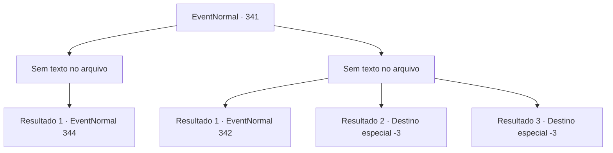

# Eventos normais · 341

[Índice da tabela](index.md) · [Índice geral](../index.md)

ID: `pt:EventNormal:341` · Fonte: `EventNormal4` · Versão: 1.2.47.

Mapeamento estático dos arquivos; a disponibilidade e a execução dependem do estado da run.

## Texto do evento

*Sem texto no arquivo.*

## Dados de entrada

```json
{
  "id": 341,
  "grade": 1,
  "place": "",
  "required": ""
}
```

## Mapa das escolhas



## Escolhas e resultados

### Escolha 1

*Sem texto no arquivo; o papel dessa opção depende da interface do jogo.*

Requisitos e outros campos da escolha:

```json
{
  "required": ""
}
```

#### Resultado 1.1

Ao derrotar o javali, alguém pula do topo de uma árvore. 

 "Esta floresta é um território dos elfos. É perigoso para os humanos. Você deveria ir para outro lugar."

 A mulher com um laço nas costas dá um aviso, mas ela mesma parece humana.

Continuação registrada: [Evento 344](0344.md) na mesma tabela.

```json
{
  "required": "",
  "chance": "1",
  "nextEvent": 344,
  "type": 2,
  "reward": ""
}
```

### Escolha 2

*Sem texto no arquivo; o papel dessa opção depende da interface do jogo.*

Requisitos e outros campos da escolha:

```json
{
  "required": ""
}
```

#### Resultado 2.1

Você é abalroado pelo javali, sendo jogado no ar. Ele passa por você e vira o corpo, emitindo um rosnado monstruoso, mas uma flecha logo voa em sua cabeça. O javali desmorona com um baque. Alguém graciosamente pula no chão, do topo de uma árvore próxima. 

 "Esta floresta é um território dos elfos. É perigoso para os humanos. Você deveria ir para outro lugar."

 A mulher com um laço nas costas dá um aviso, mas ela mesma parece humana. 

Continuação registrada: [Evento 342](0342.md) na mesma tabela.

```json
{
  "required": "1_0_2|1_1_2",
  "chance": "1",
  "nextEvent": 342,
  "type": 2,
  "reward": "0_0_-1|0_1_-1"
}
```

#### Resultado 2.2

Você não consegue se esquivar do javali, sendo abalroado e jogado no ar. Ossos quebrados perfuram seus pulmões e você perde a consciência ao dar seu último suspiro.

Continuação registrada: [Destino especial `-3`](../destinos-especiais.md).

```json
{
  "required": "2_0_2",
  "chance": "1",
  "nextEvent": -3,
  "type": 2,
  "reward": "0_0_-1|0_1_-1"
}
```

#### Resultado 2.3

Você não consegue se esquivar do javali, sendo abalroado e jogado no ar. Ossos quebrados perfuram seus pulmões e você perde a consciência ao dar seu último suspiro.

Continuação registrada: [Destino especial `-3`](../destinos-especiais.md).

```json
{
  "required": "2_1_2",
  "chance": "1",
  "nextEvent": -3,
  "type": 2,
  "reward": "0_0_-1|0_1_-1"
}
```

## Referências que chegam a este evento

- [Evento 340 · escolha 2 · resultado 1](0340.md#escolha-2)
