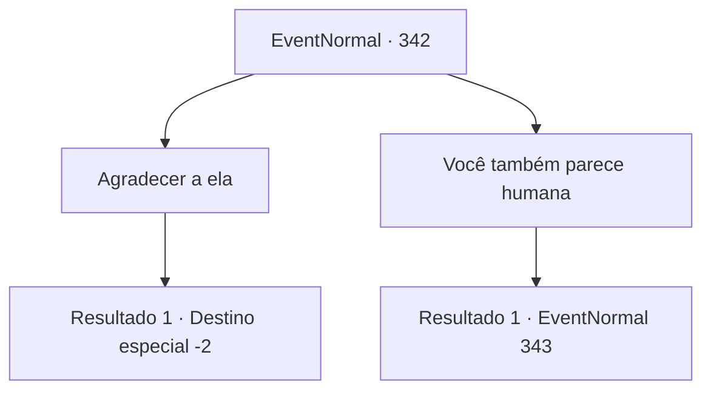

# Eventos normais · 342

[Índice da tabela](index.md) · [Índice geral](../index.md)

ID: `pt:EventNormal:342` · Fonte: `EventNormal4` · Versão: 1.2.47.

Mapeamento estático dos arquivos; a disponibilidade e a execução dependem do estado da run.

## Texto do evento

*Sem texto no arquivo.*

## Dados de entrada

```json
{
  "id": 342,
  "grade": 1,
  "place": "",
  "required": ""
}
```

## Mapa das escolhas



## Escolhas e resultados

### Escolha 1

Agradecer a ela

Requisitos e outros campos da escolha:

```json
{
  "required": ""
}
```

#### Resultado 1.1

Ela sorri e aperta as mãos. 

 "Haha! Nada para me agradecer. Só fiz o necessário. Diga, você me lembra dos meus dias de juventude, quando eu era um aventureiro. Cuidar."

 Depois de terminar, ela lhe entrega uma poção. Então ela desaparece na floresta em um piscar de olhos.

Continuação registrada: [Destino especial `-2`](../destinos-especiais.md).

```json
{
  "required": "",
  "chance": "1",
  "nextEvent": -2,
  "type": 2,
  "reward": "3_36_1|3_37_1|5_226_9"
}
```

### Escolha 2

Você também parece humana

Requisitos e outros campos da escolha:

```json
{
  "required": ""
}
```

#### Resultado 2.1

Você diz que ela se parece com um humano. Ela gentilmente te responde. 

 "Você tem razão. Eu sou um humano, mas especial para os elfos desta floresta. Você já ouviu falar da guerra entre humanos e elfos que aconteceu nesta floresta?"

  

Continuação registrada: [Evento 343](0343.md) na mesma tabela.

```json
{
  "required": "",
  "chance": "1",
  "nextEvent": 343,
  "type": 2,
  "reward": "5_226_9"
}
```

## Referências que chegam a este evento

- [Evento 340 · escolha 1 · resultado 1](0340.md#escolha-1)
- [Evento 340 · escolha 1 · resultado 2](0340.md#escolha-1)
- [Evento 340 · escolha 3 · resultado 1](0340.md#escolha-3)
- [Evento 340 · escolha 3 · resultado 2](0340.md#escolha-3)
- [Evento 340 · escolha 4 · resultado 1](0340.md#escolha-4)
- [Evento 340 · escolha 4 · resultado 2](0340.md#escolha-4)
- [Evento 341 · escolha 2 · resultado 1](0341.md#escolha-2)
