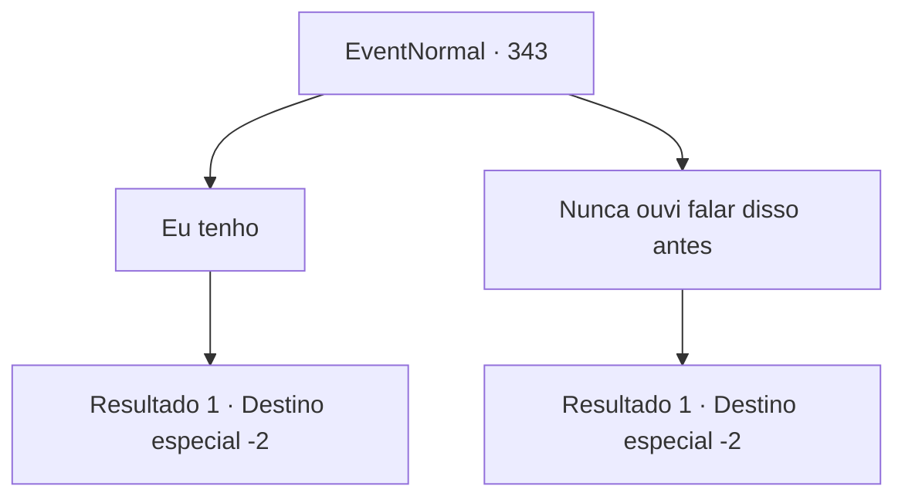

# Eventos normais · 343

[Índice da tabela](index.md) · [Índice geral](../index.md)

ID: `pt:EventNormal:343` · Fonte: `EventNormal4` · Versão: 1.2.47.

Mapeamento estático dos arquivos; a disponibilidade e a execução dependem do estado da run.

## Texto do evento

*Sem texto no arquivo.*

## Dados de entrada

```json
{
  "id": 343,
  "grade": 1,
  "place": "",
  "required": ""
}
```

## Mapa das escolhas



## Escolhas e resultados

### Escolha 1

Eu tenho

Requisitos e outros campos da escolha:

```json
{
  "required": ""
}
```

#### Resultado 1.1


 "Fiquei do lado dos elfos e fiz um grande favor a eles. O que me deu o título de 'Protetor' também."

 Ela sorri orgulhosa, colocando o peito para fora. Uma elfa loira se aproxima dela. 

 "Devemos voltar agora, já que pegamos o javali. Deliah... isso é um amigo?"

 Deliah responde balançando a cabeça. 

 "Não. Mas isso me lembrou dos meus dias de aventureiro, então conversamos por um momento."

 Ela lhe entrega uma poção, desejando-lhe sorte em suas aventuras. Então ela desaparece na floresta com o elfo.

Continuação registrada: [Destino especial `-2`](../destinos-especiais.md).

```json
{
  "required": "",
  "chance": "1",
  "nextEvent": -2,
  "type": 2,
  "reward": "3_36_1|3_37_1"
}
```

### Escolha 2

Nunca ouvi falar disso antes

Requisitos e outros campos da escolha:

```json
{
  "required": ""
}
```

#### Resultado 2.1


 "Ah, entendo... Os humanos uma vez planejaram expandir seus assentamentos para esta floresta. Para encurtar a história, eu fiquei do lado dos elfos e parei esse plano."

 Ela sorri orgulhosa, colocando o peito para fora. Uma elfa loira se aproxima dela. 

 "Devemos voltar agora, já que pegamos o javali. Deliah... isso é um amigo?"

 Deliah responde balançando a cabeça. 

 "Não. Mas isso me lembrou dos meus dias de aventureiro, então conversamos por um momento."

 Ela lhe entrega uma poção, desejando-lhe sorte em suas aventuras. Então ela desaparece na floresta com o elfo.

Continuação registrada: [Destino especial `-2`](../destinos-especiais.md).

```json
{
  "required": "",
  "chance": "1",
  "nextEvent": -2,
  "type": 2,
  "reward": "3_36_1|3_37_1"
}
```

## Referências que chegam a este evento

- [Evento 342 · escolha 2 · resultado 1](0342.md#escolha-2)
- [Evento 344 · escolha 1 · resultado 1](0344.md#escolha-1)
