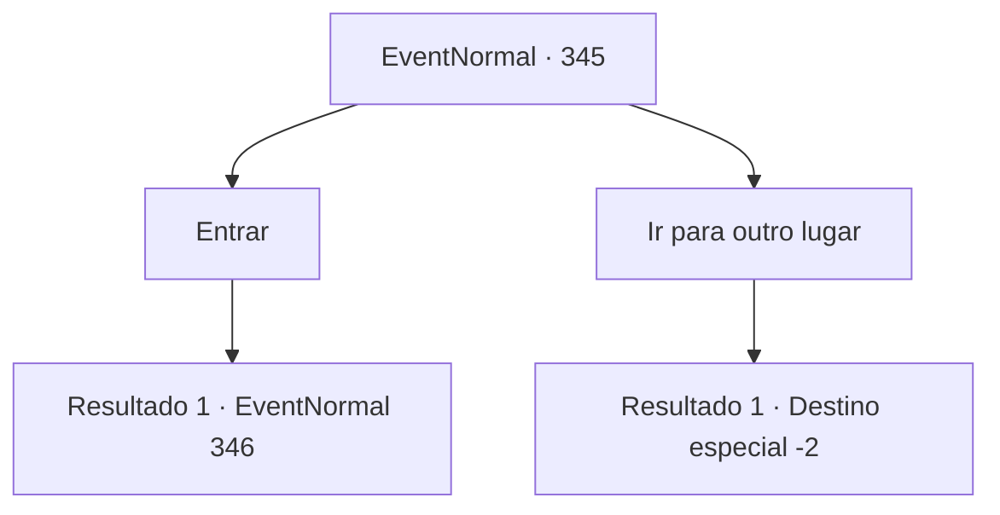

# Eventos normais · 345

[Índice da tabela](index.md) · [Índice geral](../index.md)

ID: `pt:EventNormal:345` · Fonte: `EventNormal4` · Versão: 1.2.47.

Mapeamento estático dos arquivos; a disponibilidade e a execução dependem do estado da run.

## Texto do evento

|drawing_jungle|Você está andando por uma selva exuberante, mas grama e árvores bloqueam sua visão. Então, você se depara com um grupo de árvores, emitindo uma vibração mágica. As árvores estão entrelaçadas em um arco, o que faz parecer um portal para outro mundo.

## Dados de entrada

```json
{
  "id": 345,
  "grade": 1,
  "place": "",
  "required": "5_229_0"
}
```

## Mapa das escolhas



## Escolhas e resultados

### Escolha 1

Entrar

Requisitos e outros campos da escolha:

```json
{
  "required": ""
}
```

#### Resultado 1.1

Você passa pela entrada e caminha por 10 minutos ou mais. Então, em meio à floresta exuberante, uma árvore colossal se revela. A árvore parece que foi atingida por um raio, pois está rachada ao meio e queimada, e no final da rachadura, a ponta do que parece uma espada chama sua atenção.

Continuação registrada: [Evento 346](0346.md) na mesma tabela.

```json
{
  "required": "",
  "chance": "1",
  "nextEvent": 346,
  "type": 2,
  "reward": "5_229_1"
}
```

### Escolha 2

Ir para outro lugar

Requisitos e outros campos da escolha:

```json
{
  "required": ""
}
```

#### Resultado 2.1

Você ignora a entrada mágica e segue para outro lugar.

Continuação registrada: [Destino especial `-2`](../destinos-especiais.md).

```json
{
  "required": "",
  "chance": "1",
  "nextEvent": -2,
  "type": 2,
  "reward": "5_229_1"
}
```

## Referências que chegam a este evento

Nenhum `nextEvent` positivo da mesma tabela aponta para este nó. Isso não prova que seja inacessível: sorteio e estado de história podem selecioná-lo.

