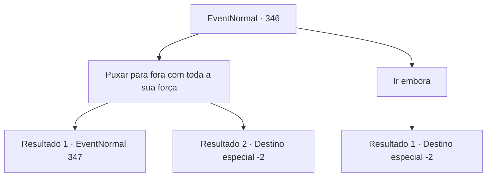

# Eventos normais · 346

[Índice da tabela](index.md) · [Índice geral](../index.md)

ID: `pt:EventNormal:346` · Fonte: `EventNormal4` · Versão: 1.2.47.

Mapeamento estático dos arquivos; a disponibilidade e a execução dependem do estado da run.

## Texto do evento

*Sem texto no arquivo.*

## Dados de entrada

```json
{
  "id": 346,
  "grade": 1,
  "place": "",
  "required": ""
}
```

## Mapa das escolhas



## Escolhas e resultados

### Escolha 1

Puxar para fora com toda a sua força

Requisitos e outros campos da escolha:

```json
{
  "required": ""
}
```

#### Resultado 1.1

Você puxa a ponta da lâmina. A espada finalmente se revela, mas dificilmente pode ser chamada de espada. Apenas a ponta pontiaguda de aço e o cabo parecem de uma espada, e o resto é feito inteiramente de tecido. E sua alça está sendo segurada por um homem velho. Ele tem um tapa-olho em um dos olhos e parece uma pessoa rude. 

 "Oww... minhas costas..."

 O velho geme ao tocar suas costas, levantando-se lentamente. Então ele aponta uma vara comprida e furada para você, gritando. |drawing_yeppi| 

 "O que! Um animal selvagem? Parece estranho."

  

Continuação registrada: [Evento 347](0347.md) na mesma tabela.

```json
{
  "required": "",
  "chance": "1|0_5_1",
  "nextEvent": 347,
  "type": 0,
  "reward": "3_218_1|5_229_2"
}
```

#### Resultado 1.2

Você puxa o topo da lâmina com toda a sua força. Mas não se mexe. Você deixa lá e vai para outro lugar.

Continuação registrada: [Destino especial `-2`](../destinos-especiais.md).

```json
{
  "required": "",
  "chance": "8",
  "nextEvent": -2,
  "type": 1,
  "reward": ""
}
```

### Escolha 2

Ir embora

Requisitos e outros campos da escolha:

```json
{
  "required": ""
}
```

#### Resultado 2.1

Você deixa lá e vai para outro lugar.

Continuação registrada: [Destino especial `-2`](../destinos-especiais.md).

```json
{
  "required": "",
  "chance": "1",
  "nextEvent": -2,
  "type": 2,
  "reward": ""
}
```

## Referências que chegam a este evento

- [Evento 345 · escolha 1 · resultado 1](0345.md#escolha-1)
