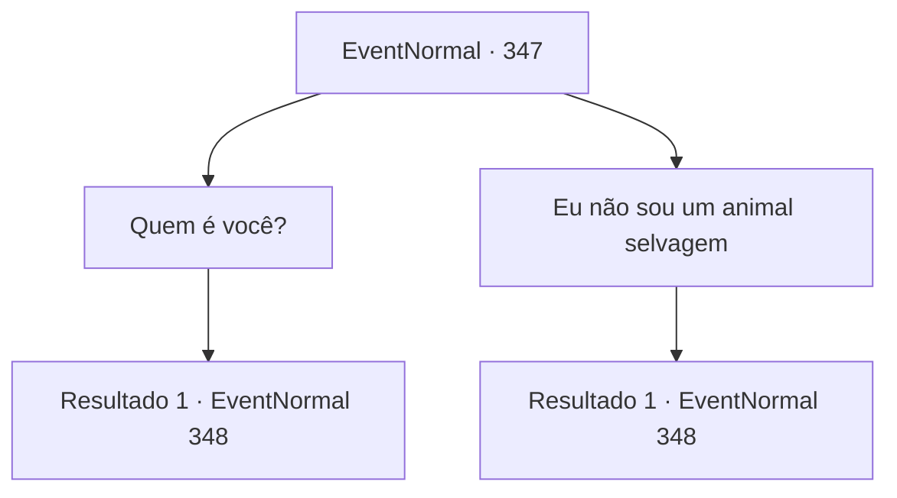

# Eventos normais · 347

[Índice da tabela](index.md) · [Índice geral](../index.md)

ID: `pt:EventNormal:347` · Fonte: `EventNormal4` · Versão: 1.2.47.

Mapeamento estático dos arquivos; a disponibilidade e a execução dependem do estado da run.

## Texto do evento

*Sem texto no arquivo.*

## Dados de entrada

```json
{
  "id": 347,
  "grade": 1,
  "place": "",
  "required": ""
}
```

## Mapa das escolhas



## Escolhas e resultados

### Escolha 1

Quem é você?

Requisitos e outros campos da escolha:

```json
{
  "required": ""
}
```

#### Resultado 1.1

Em resposta à sua pergunta, o velho endireita as costas e responde. 

 "Eu? Eu me chamo Yeppi. Eu caço animais raros de Seul."

 Você está confuso com o nome do lugar que você nunca ouviu falar, e Yeppi parece ainda mais surpreso com sua reação. 

 "Por que, estamos fora de Seul? Ah, na verdade você... você não parece nem um pouco como se fosse de Seul..."

 Ele pensa por alguns segundos e fala como se tivesse percebido algo. 

 "Ah! Deve ser isso, América! Isso é ótimo. Eu vou caçar muitas bestas raras aqui antes de retornar a Seul."

 Yeppi ri, seu rosto coberto de cicatrizes franzindo levemente.

Continuação registrada: [Evento 348](0348.md) na mesma tabela.

```json
{
  "required": "",
  "chance": "1",
  "nextEvent": 348,
  "type": 2,
  "reward": ""
}
```

### Escolha 2

Eu não sou um animal selvagem

Requisitos e outros campos da escolha:

```json
{
  "required": ""
}
```

#### Resultado 2.1

Sua resposta irrita o velho. 

 "Eu sei que! Eu não sou idiota, sabe? Eu sou Yeppi, um caçador experiente, capturando animais raros em Seul."

 Aparentemente, o velho se chama Yeppi. Você está confuso com o nome do lugar que você nunca ouviu falar, e Yeppi parece ainda mais surpreso com sua reação. 

 "Por que, estamos fora de Seul? Ah, na verdade você... você não parece nem um pouco como se fosse de Seul..."

 Ele pensa por alguns segundos e fala como se tivesse percebido algo. 

 "Ah! Deve ser isso, América! Isso é ótimo. Eu vou caçar muitas bestas raras aqui antes de retornar a Seul."

 Yeppi ri, seu rosto coberto de cicatrizes franzindo levemente.

Continuação registrada: [Evento 348](0348.md) na mesma tabela.

```json
{
  "required": "",
  "chance": "1",
  "nextEvent": 348,
  "type": 2,
  "reward": ""
}
```

## Referências que chegam a este evento

- [Evento 346 · escolha 1 · resultado 1](0346.md#escolha-1)
