# Eventos normais · 348

[Índice da tabela](index.md) · [Índice geral](../index.md)

ID: `pt:EventNormal:348` · Fonte: `EventNormal4` · Versão: 1.2.47.

Mapeamento estático dos arquivos; a disponibilidade e a execução dependem do estado da run.

## Texto do evento

*Sem texto no arquivo.*

## Dados de entrada

```json
{
  "id": 348,
  "grade": 1,
  "place": "",
  "required": ""
}
```

## Mapa das escolhas

```mermaid
flowchart TD
  E["EventNormal · 348"]
  C0["Como é esse &#x27;Seoul&#x27;?"]
  E --> C0
  R0_0["Resultado 1 · EventNormal 349"]
  C0 --> R0_0
```



## Escolhas e resultados

### Escolha 1

Como é esse 'Seoul'?

Requisitos e outros campos da escolha:

```json
{
  "required": ""
}
```

#### Resultado 1.1

Você pergunta a ele como é essa 'Seul'. Yeppi responde orgulhosamente com um rosto cheio de autoconfiança. 

 "Seul? Um lugar perfeito. Vamos ver... O ano é 2033 agora, então... já se passaram 18 anos. Desde a explosão nuclear. Depois disso, tornou-se um paraíso na terra repleto de resíduos radioativos, bandidos contaminados e fauna mutante! Corvos cobertos de óleo gritam nos céus, e no chão os humanos travam guerra por uma lata de feijão, e labirintos subterrâneos de cem andares guardam segredos misteriosos. É a terra das oportunidades, por assim dizer!"

 Ele explica Seul usando um monte de palavras que você não reconhece, mas você pode entender que é um lugar perigoso para se viver.

Continuação registrada: [Evento 349](0349.md) na mesma tabela.

```json
{
  "required": "",
  "chance": "1",
  "nextEvent": 349,
  "type": 2,
  "reward": ""
}
```

## Referências que chegam a este evento

- [Evento 347 · escolha 1 · resultado 1](0347.md#escolha-1)
- [Evento 347 · escolha 2 · resultado 1](0347.md#escolha-2)
