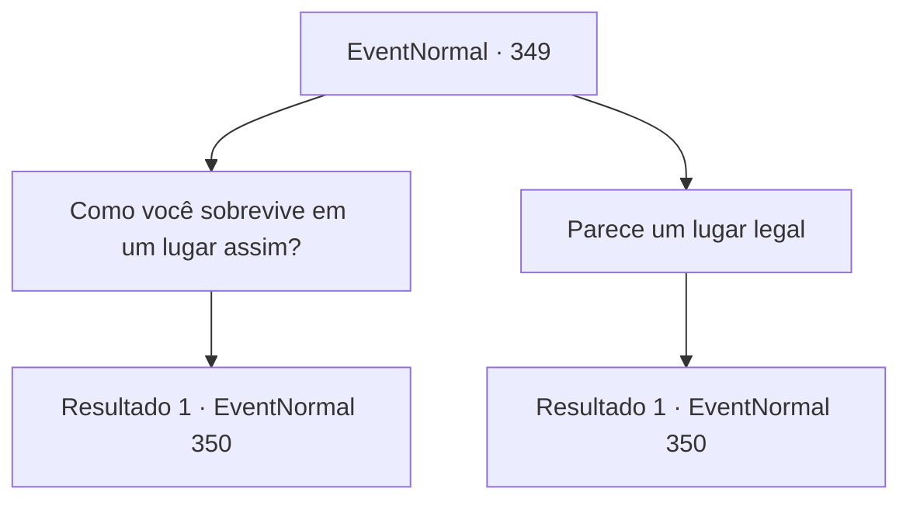

# Eventos normais · 349

[Índice da tabela](index.md) · [Índice geral](../index.md)

ID: `pt:EventNormal:349` · Fonte: `EventNormal4` · Versão: 1.2.47.

Mapeamento estático dos arquivos; a disponibilidade e a execução dependem do estado da run.

## Texto do evento

*Sem texto no arquivo.*

## Dados de entrada

```json
{
  "id": 349,
  "grade": 1,
  "place": "",
  "required": ""
}
```

## Mapa das escolhas



## Escolhas e resultados

### Escolha 1

Como você sobrevive em um lugar assim?

Requisitos e outros campos da escolha:

```json
{
  "required": ""
}
```

#### Resultado 1.1

Ele dá aquela risada assustadora de novo e responde. 

 "Você se aprimora constantemente! Definindo seus próprios objetivos!"

 Então ele te examina, circulando em torno de seu corpo, e continua. 

 "Você me lembra meu antigo aprendiz. Ele tinha olhos como os seus. Ele sempre parece estar tomando decisões importantes em sua cabeça. Bem, cada escolha tem um efeito, dizem eles. Você sabe muito bem."

 Ele não espera que você responda e continua. 

 "Oh, eu esqueci. Preciso de licença para usar armas de fogo aqui?"


Continuação registrada: [Evento 350](0350.md) na mesma tabela.

```json
{
  "required": "",
  "chance": "1",
  "nextEvent": 350,
  "type": 2,
  "reward": ""
}
```

### Escolha 2

Parece um lugar legal

Requisitos e outros campos da escolha:

```json
{
  "required": ""
}
```

#### Resultado 2.1

Ele dá aquela risada assustadora de novo e responde. 

 "É claro! Um lugar interessante. Venha se tiver tempo. Ah, você não vai precisar do seu passaporte, eu te digo."

 Então ele te examina, circulando em torno de seu corpo, e continua. 

 "Você me lembra meu antigo aprendiz. Ele tinha olhos como os seus. Ele sempre parece estar tomando decisões importantes em sua cabeça. Bem, cada escolha tem um efeito, dizem eles. Você sabe muito bem."

 Ele não espera que você responda e continua. 

 "Oh, eu esqueci. Preciso de licença para usar armas de fogo aqui?"


Continuação registrada: [Evento 350](0350.md) na mesma tabela.

```json
{
  "required": "",
  "chance": "1",
  "nextEvent": 350,
  "type": 2,
  "reward": ""
}
```

## Referências que chegam a este evento

- [Evento 348 · escolha 1 · resultado 1](0348.md#escolha-1)
