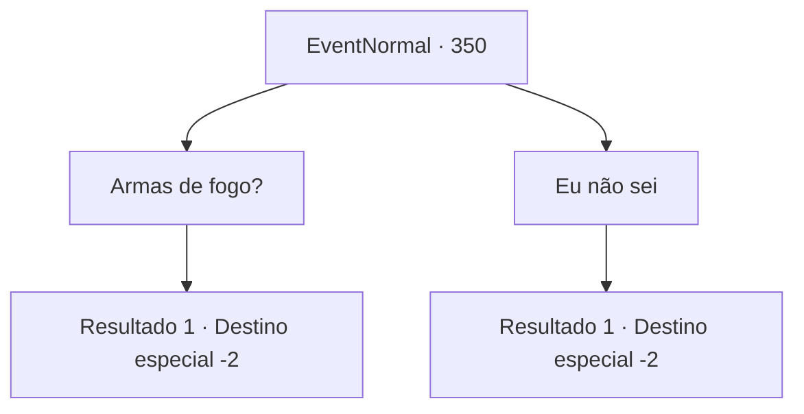

# Eventos normais · 350

[Índice da tabela](index.md) · [Índice geral](../index.md)

ID: `pt:EventNormal:350` · Fonte: `EventNormal4` · Versão: 1.2.47.

Mapeamento estático dos arquivos; a disponibilidade e a execução dependem do estado da run.

## Texto do evento

*Sem texto no arquivo.*

## Dados de entrada

```json
{
  "id": 350,
  "grade": 1,
  "place": "",
  "required": ""
}
```

## Mapa das escolhas



## Escolhas e resultados

### Escolha 1

Armas de fogo?

Requisitos e outros campos da escolha:

```json
{
  "required": ""
}
```

#### Resultado 1.1

Quando você pergunta sobre o que ele está falando, ele aponta para a longa vara que está carregando, irritado. 

 "Isso aqui. Um rifle de caça, nunca viu um? M16 não é a única arma do mundo. Este rifle é o melhor quando se trata de capturar bestas."

 Ele continua falando de algo que você realmente não entende, mas aparentemente o bastão que ele carrega é uma arma. Depois de terminar, Yeppi tira algo de seus bolsos e entrega para você. É uma lata de aço, e você sente líquido nela, depois de sacudi-la algumas vezes. 

 "Isso é carbonatado, droga... Meu, você age como uma criança. Aqui, toque na parte de abertura algumas vezes e abra-a. Isso manterá o carbono dentro. Vou procurar mais coisas para caçar agora, até mais tarde, se algum dia nos cruzarmos novamente."

 Então Yeppi desaparece na floresta.

Continuação registrada: [Destino especial `-2`](../destinos-especiais.md).

```json
{
  "required": "",
  "chance": "1",
  "nextEvent": -2,
  "type": 2,
  "reward": "3_219_1"
}
```

### Escolha 2

Eu não sei

Requisitos e outros campos da escolha:

```json
{
  "required": ""
}
```

#### Resultado 2.1

Ele acena com a cabeça, murmurando para si mesmo. 

 "É claro. Afinal, a América é um país de liberdade. Ninguém vai se importar, certo?"

 Depois de terminar, Yeppi tira algo de seus bolsos e entrega para você. É uma lata de aço, e você sente líquido nela, depois de sacudi-la algumas vezes. 

 "Isso é carbonatado, droga... Meu, você age como uma criança. Aqui, toque na parte de abertura algumas vezes e abra-a. Isso manterá o carbono dentro. Vou procurar mais coisas para caçar agora, até mais tarde, se algum dia nos cruzarmos novamente."

 Então Yeppi desaparece na floresta. 

Continuação registrada: [Destino especial `-2`](../destinos-especiais.md).

```json
{
  "required": "",
  "chance": "1",
  "nextEvent": -2,
  "type": 2,
  "reward": "3_219_1"
}
```

## Referências que chegam a este evento

- [Evento 349 · escolha 1 · resultado 1](0349.md#escolha-1)
- [Evento 349 · escolha 2 · resultado 1](0349.md#escolha-2)
