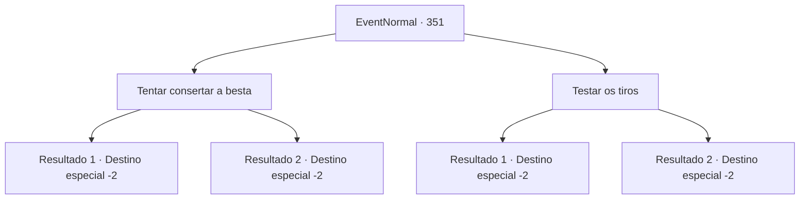

# Eventos normais · 351

[Índice da tabela](index.md) · [Índice geral](../index.md)

ID: `pt:EventNormal:351` · Fonte: `EventNormal4` · Versão: 1.2.47.

Mapeamento estático dos arquivos; a disponibilidade e a execução dependem do estado da run.

## Texto do evento

Você decide descansar em uma pequena vila, verificando a si mesmo e seus equipamentos antes da próxima aventura. Você pega sua besta e ver como ela está. Você a recarrega e aperta o gatilho, mas nada acontece.

## Dados de entrada

```json
{
  "id": 351,
  "grade": 1,
  "place": "",
  "required": "8_10_1|5_233_0"
}
```

## Mapa das escolhas



## Escolhas e resultados

### Escolha 1

Tentar consertar a besta

Requisitos e outros campos da escolha:

```json
{
  "required": ""
}
```

#### Resultado 1.1

Você desmonta a besta e a monta novamente. É mais complicado do que você pensa, mas não é realmente um grande problema para você. Você aperta os parafusos novamente e carrega a flecha novamente. Quando você dispara, a flecha viaja corretamente. Logo, a chuva para e você coloca a besta fixa de volta em sua bolsa.

Continuação registrada: [Destino especial `-2`](../destinos-especiais.md).

```json
{
  "required": "",
  "chance": "1|0_7_1|0_6_1",
  "nextEvent": -2,
  "type": 0,
  "reward": "5_233_1"
}
```

#### Resultado 1.2

Você desmonta a besta, mas não consegue montá-la novamente. Infelizmente, você abandona o que costumava ser uma besta.

Continuação registrada: [Destino especial `-2`](../destinos-especiais.md).

```json
{
  "required": "",
  "chance": "20",
  "nextEvent": -2,
  "type": 1,
  "reward": "4_10_1|5_233_1"
}
```

### Escolha 2

Testar os tiros

Requisitos e outros campos da escolha:

```json
{
  "required": ""
}
```

#### Resultado 2.1

Você acertou a besta algumas vezes. Quando você dispara, a flecha viaja corretamente. Logo, a chuva para e você coloca a besta fixa de volta em sua bolsa.

Continuação registrada: [Destino especial `-2`](../destinos-especiais.md).

```json
{
  "required": "",
  "chance": "1",
  "nextEvent": -2,
  "type": 0,
  "reward": "5_233_1"
}
```

#### Resultado 2.2

Você acertou a besta algumas vezes. Quando você dispara, agora a corda se rompe. Infelizmente, você abandona o que costumava ser uma besta.

Continuação registrada: [Destino especial `-2`](../destinos-especiais.md).

```json
{
  "required": "",
  "chance": "1",
  "nextEvent": -2,
  "type": 1,
  "reward": "4_10_1|5_233_1"
}
```

## Referências que chegam a este evento

Nenhum `nextEvent` positivo da mesma tabela aponta para este nó. Isso não prova que seja inacessível: sorteio e estado de história podem selecioná-lo.

