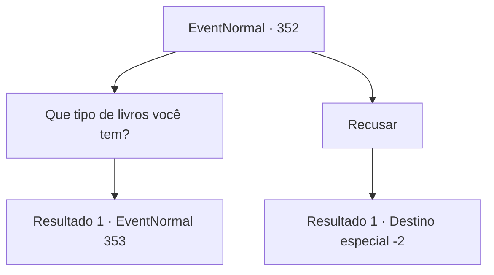

# Eventos normais · 352

[Índice da tabela](index.md) · [Índice geral](../index.md)

ID: `pt:EventNormal:352` · Fonte: `EventNormal4` · Versão: 1.2.47.

Mapeamento estático dos arquivos; a disponibilidade e a execução dependem do estado da run.

## Texto do evento

Você encontra um velho em roupas surradas nas ruas de uma cidade, sentado em uma esteira pequena, com uma pilha de livros ao lado dele. Ele vê você e fala em voz baixa. 

 "Você parece um aventureiro viajante... Você está cheio de boas energias. Sou apenas um humilde mercador de livros, mas tenho olho para as coisas."

 Ele para brevemente antes de continuar. 

 "Quer ver o que eu tenho? Os aventureiros também devem ler livros de tempos em tempos. Ora, há até um ditado. 'Um bom livro vai te levar muito, muito longe'."


## Dados de entrada

```json
{
  "id": 352,
  "grade": 1,
  "place": "",
  "required": "5_232_0|1_3_15"
}
```

## Mapa das escolhas



## Escolhas e resultados

### Escolha 1

Que tipo de livros você tem?

Requisitos e outros campos da escolha:

```json
{
  "required": ""
}
```

#### Resultado 1.1

Você pergunta a ele que tipo de livros ele tem. 

 "Vamos ver... para você... uma enciclopédia, um livro de exercícios musculares e um livro de autodefesa. Eles são velhos, então eu vou querer 50 de ouro. Sem custos adicionais. E aí, vai levar qual?"


Continuação registrada: [Evento 353](0353.md) na mesma tabela.

```json
{
  "required": "",
  "chance": "1",
  "nextEvent": 353,
  "type": 2,
  "reward": ""
}
```

### Escolha 2

Recusar

Requisitos e outros campos da escolha:

```json
{
  "required": ""
}
```

#### Resultado 2.1

Você ignora o velho e volta para fora das ruas.

Continuação registrada: [Destino especial `-2`](../destinos-especiais.md).

```json
{
  "required": "",
  "chance": "1",
  "nextEvent": -2,
  "type": 2,
  "reward": "5_232_9"
}
```

## Referências que chegam a este evento

Nenhum `nextEvent` positivo da mesma tabela aponta para este nó. Isso não prova que seja inacessível: sorteio e estado de história podem selecioná-lo.

