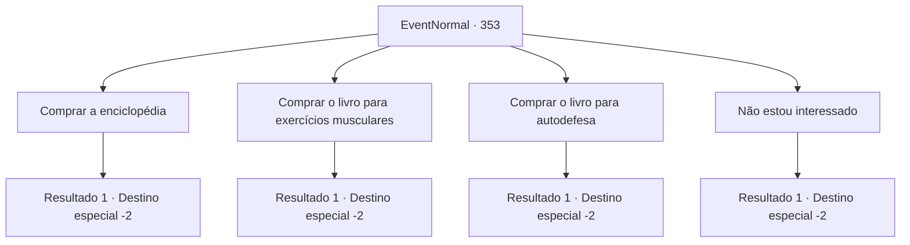

# Eventos normais · 353

[Índice da tabela](index.md) · [Índice geral](../index.md)

ID: `pt:EventNormal:353` · Fonte: `EventNormal4` · Versão: 1.2.47.

Mapeamento estático dos arquivos; a disponibilidade e a execução dependem do estado da run.

## Texto do evento

*Sem texto no arquivo.*

## Dados de entrada

```json
{
  "id": 353,
  "grade": 1,
  "place": "",
  "required": ""
}
```

## Mapa das escolhas



## Escolhas e resultados

### Escolha 1

Comprar a enciclopédia

Requisitos e outros campos da escolha:

```json
{
  "required": "1_4_50"
}
```

#### Resultado 1.1

Você pede a enciclopédia. O velho lhe entrega a enciclopédia grossa com as mãos trêmulas. 

 "Aqui.! Espero que você continue a viver uma vida cheia de boas ações. Eu... me arrependo de não ter feito isso quando tive tempo."

 Depois de terminar, o velho limpa a poeira das calças e se levanta. Ele então embala suas mercadorias em um saco de pano e vai embora.

Continuação registrada: [Destino especial `-2`](../destinos-especiais.md).

```json
{
  "required": "",
  "chance": "1",
  "nextEvent": -2,
  "type": 2,
  "reward": "5_232_1|0_4_-50|3_201_1"
}
```

### Escolha 2

Comprar o livro para exercícios musculares

Requisitos e outros campos da escolha:

```json
{
  "required": "1_4_50"
}
```

#### Resultado 2.1

Você pede o livro de exercícios musculares. O velho lhe entrega o livro com as mãos trêmulas. 

 "Aqui.! Espero que você continue a viver uma vida cheia de boas ações. Eu... me arrependo de não ter feito isso quando tive tempo."

 Depois de terminar, o velho limpa a poeira das calças e se levanta. Ele então embala suas mercadorias em um saco de pano e vai embora.

Continuação registrada: [Destino especial `-2`](../destinos-especiais.md).

```json
{
  "required": "",
  "chance": "1",
  "nextEvent": -2,
  "type": 2,
  "reward": "5_232_1|0_4_-50|3_221_1"
}
```

### Escolha 3

Comprar o livro para autodefesa

Requisitos e outros campos da escolha:

```json
{
  "required": "1_4_50"
}
```

#### Resultado 3.1

Você pede o livro de autodefesa. O velho lhe entrega o livro com as mãos trêmulas. 

 "Aqui.! Espero que você continue a viver uma vida cheia de boas ações. Eu... me arrependo de não ter feito isso quando tive tempo."

 Depois de terminar, o velho limpa a poeira das calças e se levanta. Ele então embala suas mercadorias em um saco de pano e vai embora.

Continuação registrada: [Destino especial `-2`](../destinos-especiais.md).

```json
{
  "required": "",
  "chance": "1",
  "nextEvent": -2,
  "type": 2,
  "reward": "5_232_1|0_4_-50|3_220_1"
}
```

### Escolha 4

Não estou interessado

Requisitos e outros campos da escolha:

```json
{
  "required": ""
}
```

#### Resultado 4.1

Você diz a ele que não está disposta a comprar os livros dele e se afasta da rua.

Continuação registrada: [Destino especial `-2`](../destinos-especiais.md).

```json
{
  "required": "",
  "chance": "1",
  "nextEvent": -2,
  "type": 2,
  "reward": "5_232_1"
}
```

## Referências que chegam a este evento

- [Evento 352 · escolha 1 · resultado 1](0352.md#escolha-1)
