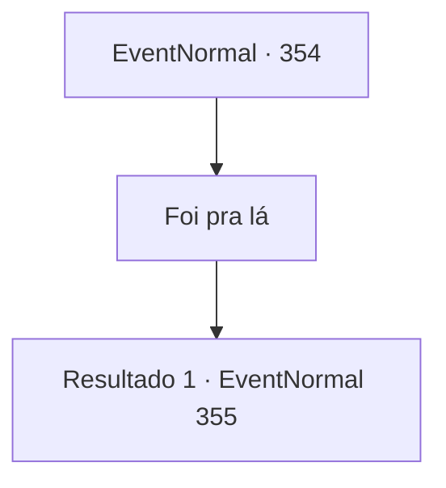

# Eventos normais · 354

[Índice da tabela](index.md) · [Índice geral](../index.md)

ID: `pt:EventNormal:354` · Fonte: `EventNormal4` · Versão: 1.2.47.

Mapeamento estático dos arquivos; a disponibilidade e a execução dependem do estado da run.

## Texto do evento

<link=shake>

 "BA--M---!!"

</link> O silêncio da floresta é quebrado por um barulho estrondoso. Com um guincho doloroso, um javali sai de um arbusto próximo e passa por você em um piscar de olhos. Yeppi, o velho que você viu da última vez, aparece logo depois. Ele animadamente fala com você. 

 "Hm? Ah, o americano. Você viu o javali que eu estava perseguindo? Essa coisa tem a velocidade de um carro! Nunca vi um javali desse tamanho. Os animais americanos são tão grandes assim?"


## Dados de entrada

```json
{
  "id": 354,
  "grade": 1,
  "place": "",
  "required": "5_229_2"
}
```

## Mapa das escolhas



## Escolhas e resultados

### Escolha 1

Foi pra lá

Requisitos e outros campos da escolha:

```json
{
  "required": ""
}
```

#### Resultado 1.1

Diga a ele para onde o javali fugiu. Ele responde com raiva. 

 "Ah, claro que eu sei disso! O que eu quis dizer foi, você já viu um javali desse tamanho. De qualquer forma, você pega a direita. Eu vou para a esquerda."

 Ele vai atrás do javali depois de terminar.

Continuação registrada: [Evento 355](0355.md) na mesma tabela.

```json
{
  "required": "",
  "chance": "1",
  "nextEvent": 355,
  "type": 2,
  "reward": ""
}
```

## Referências que chegam a este evento

Nenhum `nextEvent` positivo da mesma tabela aponta para este nó. Isso não prova que seja inacessível: sorteio e estado de história podem selecioná-lo.

