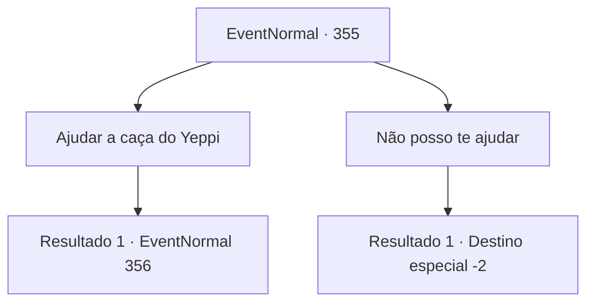

# Eventos normais · 355

[Índice da tabela](index.md) · [Índice geral](../index.md)

ID: `pt:EventNormal:355` · Fonte: `EventNormal4` · Versão: 1.2.47.

Mapeamento estático dos arquivos; a disponibilidade e a execução dependem do estado da run.

## Texto do evento

*Sem texto no arquivo.*

## Dados de entrada

```json
{
  "id": 355,
  "grade": 1,
  "place": "",
  "required": ""
}
```

## Mapa das escolhas



## Escolhas e resultados

### Escolha 1

Ajudar a caça do Yeppi

Requisitos e outros campos da escolha:

```json
{
  "required": ""
}
```

#### Resultado 1.1

Como Yeppi pediu, você circula à sua direita e tenta cercar o javali. Ele continua a fugir de você, em uma clareira oca desprovida de árvores, e você ouve o som estrondoso novamente. O javali, não conseguindo parar o controle de sua própria velocidade, cai no chão. 

 "Hahaha!! Obrigado! Você conseguiu fazer isso!"

 O rosto de Yeppi, ainda cheio de cicatrizes e rugas, sorri. Logo, você sente algo enorme se aproximando de você de cima. Quando você olha para cima, um grifo se mostra com o som de galhos de árvores se quebrando. Enquanto o grifo se aproxima do corpo sem vida do javali, Yeppi grita de espanto. 

 "O que... o que é agora! Um pássaro enorme!!"

 Ele prepara sua longa vara, puxando o gatilho, e dispara fogo com outro som estrondoso. 

 "SCRREEECHH--!!"

 Sangue carmesim respinga do corpo do grifo. Ele grita de dor, correndo para o velho, e ele é pego por suas garras. Ele é jogado para longe. O grifo agora se aproxima de você.

Continuação registrada: [Evento 356](0356.md) na mesma tabela.

```json
{
  "required": "",
  "chance": "1",
  "nextEvent": 356,
  "type": 2,
  "reward": ""
}
```

### Escolha 2

Não posso te ajudar

Requisitos e outros campos da escolha:

```json
{
  "required": ""
}
```

#### Resultado 2.1

Você decide ignorar o caçador lunático. Os ruídos estrondosos podem ser ouvidos mais algumas vezes. A floresta então fica tranquila novamente. Você é indiferente aos ruídos, enquanto continua andando.

Continuação registrada: [Destino especial `-2`](../destinos-especiais.md).

```json
{
  "required": "",
  "chance": "1",
  "nextEvent": -2,
  "type": 2,
  "reward": "5_229_9"
}
```

## Referências que chegam a este evento

- [Evento 354 · escolha 1 · resultado 1](0354.md#escolha-1)
