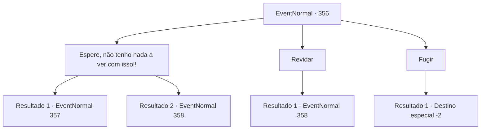

# Eventos normais · 356

[Índice da tabela](index.md) · [Índice geral](../index.md)

ID: `pt:EventNormal:356` · Fonte: `EventNormal4` · Versão: 1.2.47.

Mapeamento estático dos arquivos; a disponibilidade e a execução dependem do estado da run.

## Texto do evento

*Sem texto no arquivo.*

## Dados de entrada

```json
{
  "id": 356,
  "grade": 1,
  "place": "",
  "required": ""
}
```

## Mapa das escolhas



## Escolhas e resultados

### Escolha 1

Espere, não tenho nada a ver com isso!!

Requisitos e outros campos da escolha:

```json
{
  "required": ""
}
```

#### Resultado 1.1

Você alega inocência ao grifo furioso. Aparentemente, o grifo entende você, pois pega o corpo do javali e voa para longe. Depois que o grifo sai, você procura por Yeppi. Ele está sentado ao lado de um tronco de árvore, respirando pesadamente. 

 "Uck... isso... maldito... tosse...! Pássaro..."

 Yeppi olha para você, cospe sangue e continua. 

 "Ah, eles disseram que... as pessoas sempre morrem fazendo as coisas que mais amam.... talvez seja verdade. Ei, americano... se eu morrer... pegue meu rifle..."


Continuação registrada: [Evento 357](0357.md) na mesma tabela.

```json
{
  "required": "",
  "chance": "1|0_12_1",
  "nextEvent": 357,
  "type": 0,
  "reward": ""
}
```

#### Resultado 1.2

Você alega inocência ao grifo furioso. Mas o grifo não escuta. Mesmo enquanto sangra, ele está balançando suas garras afiadas. 

Continuação registrada: [Evento 358](0358.md) na mesma tabela.

```json
{
  "required": "",
  "chance": "13",
  "nextEvent": 358,
  "type": 1,
  "reward": "6_2_53",
  "place": 1
}
```

### Escolha 2

Revidar

Requisitos e outros campos da escolha:

```json
{
  "required": ""
}
```

#### Resultado 2.1

O grifo parece gravemente ferido, do golpe anterior. Você prepara sua arma e enfrenta o grifo.

Continuação registrada: [Evento 358](0358.md) na mesma tabela.

```json
{
  "required": "",
  "chance": "1",
  "nextEvent": 358,
  "type": 2,
  "reward": "6_2_53",
  "place": 1
}
```

### Escolha 3

Fugir

Requisitos e outros campos da escolha:

```json
{
  "required": ""
}
```

#### Resultado 3.1

Você foge do grifo com todas as suas forças, e felizmente não vem atrás de você.

Continuação registrada: [Destino especial `-2`](../destinos-especiais.md).

```json
{
  "required": "",
  "chance": "1",
  "nextEvent": -2,
  "type": 2,
  "reward": "5_229_9"
}
```

## Referências que chegam a este evento

- [Evento 355 · escolha 1 · resultado 1](0355.md#escolha-1)
