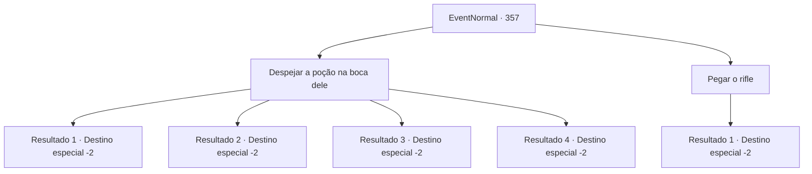

# Eventos normais · 357

[Índice da tabela](index.md) · [Índice geral](../index.md)

ID: `pt:EventNormal:357` · Fonte: `EventNormal4` · Versão: 1.2.47.

Mapeamento estático dos arquivos; a disponibilidade e a execução dependem do estado da run.

## Texto do evento

*Sem texto no arquivo.*

## Dados de entrada

```json
{
  "id": 357,
  "grade": 1,
  "place": "",
  "required": ""
}
```

## Mapa das escolhas



## Escolhas e resultados

### Escolha 1

Despejar a poção na boca dele

Requisitos e outros campos da escolha:

```json
{
  "required": ""
}
```

#### Resultado 1.1

Você coloca uma poção de saúde na boca de Yeppi morrendo. A poção faz bem o seu trabalho, curando as feridas do velho, e logo Yeppi está saudável novamente. 

 "Uh...! Parece que você salvou minha vida. Obrigada. Por me deixar caçar mais. Aqui. Por salvar minha vida."

 Ele lhe entrega um punhado de ouro e sai para procurar outros monstros. 

Continuação registrada: [Destino especial `-2`](../destinos-especiais.md).

```json
{
  "required": "8_36_1",
  "chance": "1",
  "nextEvent": -2,
  "type": 2,
  "reward": "3_217_1|0_3_5|4_36_1|5_229_9|0_2_1|0_4_50"
}
```

#### Resultado 1.2

Você coloca uma poção de saúde na boca de Yeppi morrendo. A poção faz bem o seu trabalho, curando as feridas do velho, e logo Yeppi está saudável novamente. 

 "Uh...! Parece que você salvou minha vida. Que tipo de remédio é esse? Tem um gosto tão... fresco..! Obrigada. Por me deixar caçar mais. Aqui. Por salvar minha vida."

 Ele lhe entrega um punhado de ouro e sai para procurar outros monstros. 

Continuação registrada: [Destino especial `-2`](../destinos-especiais.md).

```json
{
  "required": "8_130_1",
  "chance": "1",
  "nextEvent": -2,
  "type": 2,
  "reward": "3_217_1|0_3_5|4_130_1|5_229_9|0_2_1|0_4_50"
}
```

#### Resultado 1.3

Você coloca uma poção de saúde na boca de Yeppi morrendo. Mas, infelizmente, ele não consegue se recuperar. Depois de você se curvar em silêncio, quando você olha para cima, o corpo dele se foi. Você pega o 'rifle' dele e volta para suas aventuras.

Continuação registrada: [Destino especial `-2`](../destinos-especiais.md).

```json
{
  "required": "8_190_1",
  "chance": "1",
  "nextEvent": -2,
  "type": 2,
  "reward": "3_222_1|0_3_3|4_190_1|5_229_9|0_2_1"
}
```

#### Resultado 1.4

Você procura dentro de sua bolsa, mas não há poção de saúde para Yeppi. Infelizmente, ele dá seu último suspiro, e seu corpo lentamente começa a desaparecer, finalmente desaparecendo completamente como se não estivesse lá em primeiro lugar. Você pega o 'rifle' dele e volta para suas aventuras.

Continuação registrada: [Destino especial `-2`](../destinos-especiais.md).

```json
{
  "required": "10_36_1|10_130_1|10_190_1",
  "chance": "1",
  "nextEvent": -2,
  "type": 2,
  "reward": "3_222_1|0_2_1|5_229_9"
}
```

### Escolha 2

Pegar o rifle

Requisitos e outros campos da escolha:

```json
{
  "required": ""
}
```

#### Resultado 2.1

Você pega o 'rifle' de Yeppi. Infelizmente, ele dá seu último suspiro, e seu corpo lentamente começa a desaparecer, finalmente desaparecendo completamente como se não estivesse lá em primeiro lugar. Você pega o 'rifle' dele e volta para suas aventuras.

Continuação registrada: [Destino especial `-2`](../destinos-especiais.md).

```json
{
  "required": "",
  "chance": "1",
  "nextEvent": -2,
  "type": 2,
  "reward": "3_222_1|0_2_1|5_229_9"
}
```

## Referências que chegam a este evento

- [Evento 356 · escolha 1 · resultado 1](0356.md#escolha-1)
- [Evento 358 · escolha 1 · resultado 1](0358.md#escolha-1)
