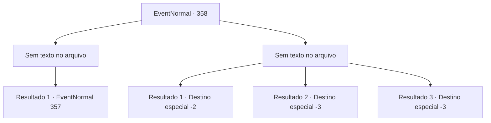

# Eventos normais · 358

[Índice da tabela](index.md) · [Índice geral](../index.md)

ID: `pt:EventNormal:358` · Fonte: `EventNormal4` · Versão: 1.2.47.

Mapeamento estático dos arquivos; a disponibilidade e a execução dependem do estado da run.

## Texto do evento

*Sem texto no arquivo.*

## Dados de entrada

```json
{
  "id": 358,
  "grade": 1,
  "place": "",
  "required": ""
}
```

## Mapa das escolhas



## Escolhas e resultados

### Escolha 1

*Sem texto no arquivo; o papel dessa opção depende da interface do jogo.*

Requisitos e outros campos da escolha:

```json
{
  "required": ""
}
```

#### Resultado 1.1

O grifo já está gravemente ferido, então acabar com ele não é tão difícil. Passando pelo grifo caído, você caminha na direção para a qual Yeppi foi jogado. Ele está sentado ao lado de um tronco de árvore, respirando pesadamente. 

 "Uck... isso... maldito... tosse...! Pássaro..."

 Yeppi olha para você, cospe sangue e continua. 

 "Ah, eles disseram que... as pessoas sempre morrem fazendo as coisas que mais amam.... talvez seja verdade. Ei, americano... se eu morrer... pegue meu rifle..."

 

Continuação registrada: [Evento 357](0357.md) na mesma tabela.

```json
{
  "required": "",
  "chance": "1",
  "nextEvent": 357,
  "type": 2,
  "reward": ""
}
```

### Escolha 2

*Sem texto no arquivo; o papel dessa opção depende da interface do jogo.*

Requisitos e outros campos da escolha:

```json
{
  "required": ""
}
```

#### Resultado 2.1

Você luta contra o grifo, mas a única coisa que consegue é outra ferida. Você manca para longe dele, e o grifo abandona a perseguição imediatamente, como se não estivesse interessado em você.

Continuação registrada: [Destino especial `-2`](../destinos-especiais.md).

```json
{
  "required": "1_0_2|1_1_2",
  "chance": "1",
  "nextEvent": -2,
  "type": 2,
  "reward": "5_229_9|0_0_-1|0_1_-1"
}
```

#### Resultado 2.2

As garras afiadas do grifo cortam sua carne e quebram seus ossos. Os ataques do grifo furioso são implacáveis, e você tosse sangue e desmaia.

Continuação registrada: [Destino especial `-3`](../destinos-especiais.md).

```json
{
  "required": "2_0_2",
  "chance": "1",
  "nextEvent": -3,
  "type": 2,
  "reward": "0_0_-1|0_1_-1"
}
```

#### Resultado 2.3

As garras afiadas do grifo cortam sua carne e quebram seus ossos. Os ataques do grifo furioso são implacáveis, e você tosse sangue e desmaia.

Continuação registrada: [Destino especial `-3`](../destinos-especiais.md).

```json
{
  "required": "2_1_2",
  "chance": "1",
  "nextEvent": -3,
  "type": 2,
  "reward": "0_0_-1|0_1_-1"
}
```

## Referências que chegam a este evento

- [Evento 356 · escolha 1 · resultado 2](0356.md#escolha-1)
- [Evento 356 · escolha 2 · resultado 1](0356.md#escolha-2)
