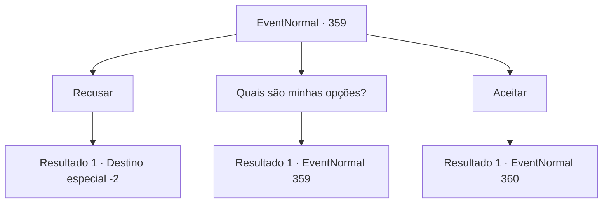

# Eventos normais · 359

[Índice da tabela](index.md) · [Índice geral](../index.md)

ID: `pt:EventNormal:359` · Fonte: `EventNormal4` · Versão: 1.2.47.

Mapeamento estático dos arquivos; a disponibilidade e a execução dependem do estado da run.

## Texto do evento

Você chega a uma cidade chamada 'Rom'. A cidade é famosa por um coliseu circular de gladiadores construído com mármore, e acontece que uma partida está sendo realizada agora. Na platéia, todos os tipos de pessoas, sejam homens ou mulheres, crianças ou idosos, estão torcendo por seus lutadores favoritos, e mercadores aqui e ali estão atraindo clientes. Enquanto você está olhando ao redor do coliseu, um homem vestindo uma túnica preta se aproxima de você. 

 "A partida começará em breve. Que tal? Você quer apoiar o seu favorito? 50 ouros."


## Dados de entrada

```json
{
  "id": 359,
  "grade": 1,
  "place": "",
  "required": "5_234_0"
}
```

## Mapa das escolhas



## Escolhas e resultados

### Escolha 1

Recusar

Requisitos e outros campos da escolha:

```json
{
  "required": ""
}
```

#### Resultado 1.1

Enquanto você balança a cabeça e diz a ele que você será simplesmente um espectador, o homem estala a língua e sai. E logo depois, a luta começa. Você olha fixamente para a luta, sem nenhum favorito escolhido, e sai do Coliseu enquanto a luta ainda está em andamento.

Continuação registrada: [Destino especial `-2`](../destinos-especiais.md).

```json
{
  "required": "",
  "chance": "1",
  "nextEvent": -2,
  "type": 2,
  "reward": "5_234_9"
}
```

### Escolha 2

Quais são minhas opções?

Requisitos e outros campos da escolha:

```json
{
  "required": "5_234_0"
}
```

#### Resultado 2.1

Ele responde apontando para os gladiadores um por um. 

 "Aquilo ali é 'Sandra mais forte que os ursos'. Recebeu esse nome depois que ela derrotou sozinha um urso selvagem com os punhos nus. Um lutador de força bruta considerável, sem dúvida. E que existe 'Kahan, a Víbora'. Não só ele parece uma víbora, seu estilo de luta combina com o nome, astuto e rápido. Por último, mas não menos importante, ouvi dizer que 'Achille the Butcher' é um ex-mercenário que passou por inúmeras campanhas. Os lances são 2,7:2,3:2,1, respectivamente."


Continuação registrada: [Evento 359](0359.md) na mesma tabela.

```json
{
  "required": "",
  "chance": "1",
  "nextEvent": 359,
  "type": 2,
  "reward": "5_234_1"
}
```

### Escolha 3

Aceitar

Requisitos e outros campos da escolha:

```json
{
  "required": "1_4_50"
}
```

#### Resultado 3.1


 "Boa escolha. Quem será sua escolha?"

 Ele te pergunta com uma voz assustadora, pegando 50 de ouro de você.

Continuação registrada: [Evento 360](0360.md) na mesma tabela.

```json
{
  "required": "",
  "chance": "1",
  "nextEvent": 360,
  "type": 2,
  "reward": "0_4_-50|5_234_9"
}
```

## Referências que chegam a este evento

- [Evento 359 · escolha 2 · resultado 1](0359.md#escolha-2)
