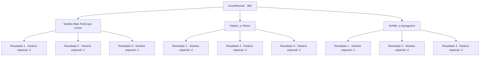

# Eventos normais · 360

[Índice da tabela](index.md) · [Índice geral](../index.md)

ID: `pt:EventNormal:360` · Fonte: `EventNormal4` · Versão: 1.2.47.

Mapeamento estático dos arquivos; a disponibilidade e a execução dependem do estado da run.

## Texto do evento

*Sem texto no arquivo.*

## Dados de entrada

```json
{
  "id": 360,
  "grade": 1,
  "place": "",
  "required": ""
}
```

## Mapa das escolhas



## Escolhas e resultados

### Escolha 1

Sandra Mais Forte que Ursos

Requisitos e outros campos da escolha:

```json
{
  "required": ""
}
```

#### Resultado 1.1

Você decide torcer por Sandra. Assim que a luta começa, ela começa a balançar seu machado de batalha ferozmente, e tanto 'Achille a Açougueira' quanto 'Kahan a Víbora' não são páreo para ela. Sandra ergue seu machado de batalha ensanguentado em vitória, e a multidão vai à loucura gritando o nome dela. 

 "SANDRA! SANDRA! SANDRA!"

 Você pega o prêmio em dinheiro, bem merecido por sua visão, e sai feliz do coliseu.

Continuação registrada: [Destino especial `-2`](../destinos-especiais.md).

```json
{
  "required": "",
  "chance": "29",
  "nextEvent": -2,
  "type": 2,
  "reward": "0_4_135"
}
```

#### Resultado 1.2

Você decide torcer por Sandra. Assim que a luta começa, ela começa a balançar seu machado de batalha ferozmente. Mas 'Kahan a Víbora' aproveita a oportunidade para emboscar Sandra em um piscar de olhos, o que faz Sandra cair no chão. Quem estava torcendo por Sandra fica em silêncio, e os outros começam a aplaudir ainda mais alto. Sua percepção errada custa dinheiro e você sai do coliseu.

Continuação registrada: [Destino especial `-2`](../destinos-especiais.md).

```json
{
  "required": "",
  "chance": "32",
  "nextEvent": -2,
  "type": 2,
  "reward": ""
}
```

#### Resultado 1.3

Você decide torcer por Sandra. Assim que a luta começa, ela começa a balançar seu machado de batalha ferozmente. Mas 'Achille a Açougueira' usa sua experiência para desferir um ataque preciso e mortal, que faz Sandra cair no chão. Aqueles que estavam torcendo por Sandra ficam em silêncio imediatamente, e os outros começam a aplaudir ainda mais alto. Sua percepção errada custa dinheiro e você sai do coliseu.

Continuação registrada: [Destino especial `-2`](../destinos-especiais.md).

```json
{
  "required": "",
  "chance": "38",
  "nextEvent": -2,
  "type": 2,
  "reward": ""
}
```

### Escolha 2

Kahan, a Víbora

Requisitos e outros campos da escolha:

```json
{
  "required": ""
}
```

#### Resultado 2.1

Você decide torcer por Kahan. Kahan tenta provocar uma briga entre 'Sandra Mais Forte que Ursos' e 'Achille a Açougueira', mas Sandra ignora e ataca Kahan primeiro. À medida que a enxurrada de ataques continua, Achille também ataca as costas de Kahan, e ele cai de pé logo depois. Aqueles que estavam torcendo por Kahan ficam em silêncio, e os outros começam a aplaudir ainda mais alto. Sua percepção errada custa dinheiro e você sai do coliseu.

Continuação registrada: [Destino especial `-2`](../destinos-especiais.md).

```json
{
  "required": "",
  "chance": "29",
  "nextEvent": -2,
  "type": 2,
  "reward": ""
}
```

#### Resultado 2.2

Você decide torcer por Kahan. Kahan, como seu apelido sugere, é um gladiador habilidoso em emboscadas e jogos mentais, auxiliado por sua agilidade. Ele provoca uma briga entre 'Achille a Açougueira' e 'Sandra Mais Forte que Ursos'. Quando o duelo atinge o clímax, Kahan embosca os dois e sai vitorioso. 

 "Ahahahah!! A vitória é minha!"

 Quando ele levanta a mão com a adaga, a multidão também aplaude. Você pega o prêmio em dinheiro, merecido por sua visão, e sai feliz do Coliseu.

Continuação registrada: [Destino especial `-2`](../destinos-especiais.md).

```json
{
  "required": "",
  "chance": "32",
  "nextEvent": -2,
  "type": 2,
  "reward": "0_4_115"
}
```

#### Resultado 2.3

Você decide torcer por Kahan. Kahan tenta provocar uma briga entre 'Sandra Mais Forte que Ursos' e 'Achille a Açougueira', mas o experiente mercenário não se deixa enganar por seus jogos mentais. Kahan é atacado por Achille e Sandra, logo caindo no chão. Aqueles que estavam torcendo por ele ficam em silêncio, e os outros começam a torcer ainda mais alto. Sua percepção errada custa dinheiro e você sai do coliseu.

Continuação registrada: [Destino especial `-2`](../destinos-especiais.md).

```json
{
  "required": "",
  "chance": "38",
  "nextEvent": -2,
  "type": 2,
  "reward": ""
}
```

### Escolha 3

Achille, a Açougueira

Requisitos e outros campos da escolha:

```json
{
  "required": ""
}
```

#### Resultado 3.1

Você decide torcer por Achille. Ele é um veterano com muita experiência em guerras, mas aparentemente não está familiarizado com esse tipo de luta. Ataques de 'Sandra Mais Forte que Ursos' joga sua arma voando no ar, e ele é derrotado. Aqueles que estavam torcendo por Achille fica em silêncio, e os outros começam a aplaudir ainda mais alto. Sua percepção errada custa dinheiro e você sai do coliseu.

Continuação registrada: [Destino especial `-2`](../destinos-especiais.md).

```json
{
  "required": "",
  "chance": "29",
  "nextEvent": -2,
  "type": 2,
  "reward": ""
}
```

#### Resultado 3.2

Você decide torcer por Achille. Ele é um veterano com muita experiência em guerras, mas aparentemente não está familiarizado com esse tipo de combate. 'Kahan a Víbora' o embosca, tirando a arma de Achille de sua mão, e ele é derrotado. Aqueles que estavam torcendo por Achille fica em silêncio, e os outros começam a aplaudir ainda mais alto. Sua percepção errada custa dinheiro e você sai do coliseu.

Continuação registrada: [Destino especial `-2`](../destinos-especiais.md).

```json
{
  "required": "",
  "chance": "32",
  "nextEvent": -2,
  "type": 2,
  "reward": ""
}
```

#### Resultado 3.3

Você decide torcer por Achille. Fazendo uso de suas experiências em combate de suas campanhas anteriores, ele graciosamente evita os ataques de 'Sandra Mais Forte que Ursos' e 'Kahan a Víbora' e derrota os dois. 

 "AQUILÊ! AQUILO! AQUILO!"

 Achille se curva para a multidão aplaudindo seu nome, e você pega o prêmio em dinheiro, bem merecido por sua visão, e sai feliz do Coliseu.

Continuação registrada: [Destino especial `-2`](../destinos-especiais.md).

```json
{
  "required": "",
  "chance": "38",
  "nextEvent": -2,
  "type": 2,
  "reward": "0_4_105"
}
```

## Referências que chegam a este evento

- [Evento 359 · escolha 3 · resultado 1](0359.md#escolha-3)
