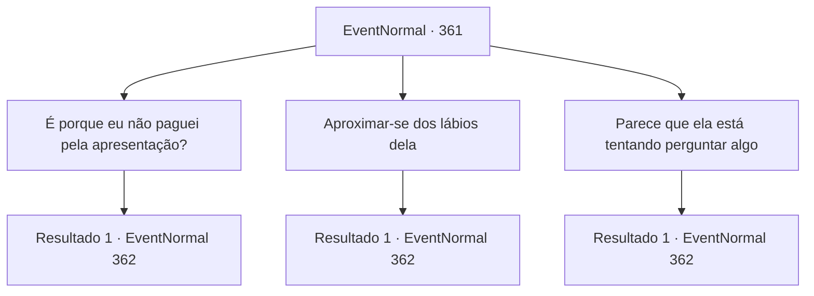

# Eventos normais · 361

[Índice da tabela](index.md) · [Índice geral](../index.md)

ID: `pt:EventNormal:361` · Fonte: `EventNormal4` · Versão: 1.2.47.

Mapeamento estático dos arquivos; a disponibilidade e a execução dependem do estado da run.

## Texto do evento

Enquanto você está vagando por uma cidade chamada 'Chronie', você se depara com um circo, se apresentando na praça da cidade. Melodias alegres, movimentos graciosos dos dançarinos e a emocionante performance dos acrobatas aliviam sua exaustão de todas as aventuras. Depois que a performance chega ao fim, o público começa a jogar moedas. É quando você faz contato visual com uma das dançarinas. Ela imediatamente desce do palco, se aproximando de você.

## Dados de entrada

```json
{
  "id": 361,
  "grade": 1,
  "place": "",
  "required": "1_2_50|5_236_0"
}
```

## Mapa das escolhas



## Escolhas e resultados

### Escolha 1

É porque eu não paguei pela apresentação?

Requisitos e outros campos da escolha:

```json
{
  "required": ""
}
```

#### Resultado 1.1

Você olha ao redor. Mas você não é o único que está curtindo a apresentação de graça, então ela deve estar se aproximando de você por um motivo diferente. 

 "Você é {1}, certo? Por favor, eu preciso que você me ouça!"

 Ela parece desesperada, segurando as mãos em um movimento de oração, contando sua história. Segundo ela, ela tinha uma irmã, que se casou com um aventureiro há alguns anos, estabelecendo-se em uma cidade chamada 'Kargo'. O casamento não interrompeu o vínculo fraternal, e as duas trocaram mensagens, enviando cartas e mantendo o controle. Mas depois de não ter notícias de sua irmã por um ano, ela foi vê-la pessoalmente e encontrou sua irmã morta. 

 "Aquele bastardo... deve ter assassinado minha irmã...! Por que mais ele não diria uma maldita coisa para mim?! Por favor, mate-o e complete essa vingança para mim e minha irmã!"


Continuação registrada: [Evento 362](0362.md) na mesma tabela.

```json
{
  "required": "",
  "chance": "1",
  "nextEvent": 362,
  "type": 2,
  "reward": ""
}
```

### Escolha 2

Aproximar-se dos lábios dela

Requisitos e outros campos da escolha:

```json
{
  "required": ""
}
```

#### Resultado 2.1

Você tenta uma abordagem romântica e alcança os lábios dela. Mas o que sai de sua boca é totalmente inesperado. 

 "Você é {1}, certo? Por favor, eu preciso que você me ouça!"

 Ela parece desesperada, segurando as mãos em um movimento de oração, contando sua história. Segundo ela, ela tinha uma irmã, que se casou com um aventureiro há alguns anos, estabelecendo-se em uma cidade chamada 'Kargo'. O casamento não interrompeu o vínculo fraternal, e as duas trocaram mensagens, enviando cartas e mantendo o controle. Mas depois de não ter notícias de sua irmã por um ano, ela foi vê-la pessoalmente e encontrou sua irmã morta. 

 "Aquele bastardo... deve ter assassinado minha irmã...! Por que mais ele não diria uma maldita coisa para mim?! Por favor, mate-o e complete essa vingança para mim e minha irmã!"


Continuação registrada: [Evento 362](0362.md) na mesma tabela.

```json
{
  "required": "",
  "chance": "1",
  "nextEvent": 362,
  "type": 2,
  "reward": ""
}
```

### Escolha 3

Parece que ela está tentando perguntar algo

Requisitos e outros campos da escolha:

```json
{
  "required": ""
}
```

#### Resultado 3.1

Você sente que ela está se aproximando de você para lhe perguntar algo. E você estava certo. 

 "Você é {1}, certo? Por favor, eu preciso que você me ouça!"

 Ela parece desesperada, segurando as mãos em um movimento de oração, contando sua história. Segundo ela, ela tinha uma irmã, que se casou com um aventureiro há alguns anos, estabelecendo-se em uma cidade chamada 'Kargo'. O casamento não interrompeu o vínculo fraternal, e as duas trocaram mensagens, enviando cartas e mantendo o controle. Mas depois de não ter notícias de sua irmã por um ano, ela foi vê-la pessoalmente e encontrou sua irmã morta. 

 "Aquele bastardo... deve ter assassinado minha irmã...! Por que mais ele não diria uma maldita coisa para mim?! Por favor, mate-o e complete essa vingança para mim e minha irmã!"


Continuação registrada: [Evento 362](0362.md) na mesma tabela.

```json
{
  "required": "",
  "chance": "1",
  "nextEvent": 362,
  "type": 2,
  "reward": ""
}
```

## Referências que chegam a este evento

Nenhum `nextEvent` positivo da mesma tabela aponta para este nó. Isso não prova que seja inacessível: sorteio e estado de história podem selecioná-lo.

