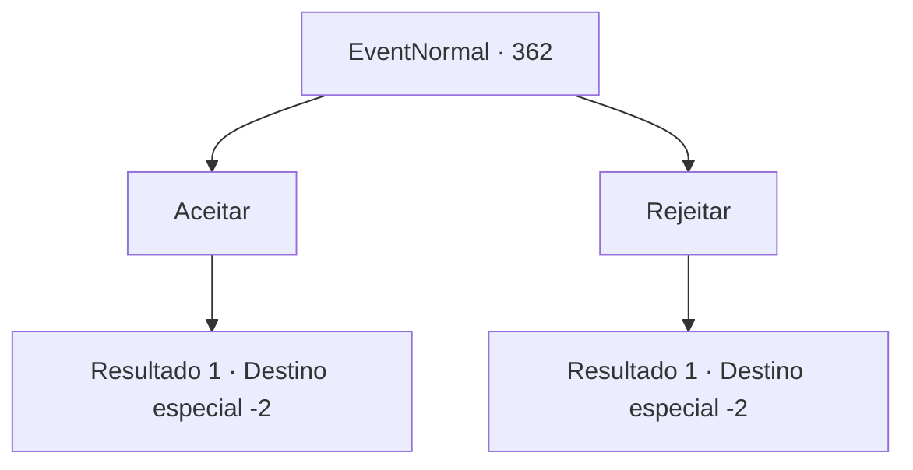

# Eventos normais · 362

[Índice da tabela](index.md) · [Índice geral](../index.md)

ID: `pt:EventNormal:362` · Fonte: `EventNormal4` · Versão: 1.2.47.

Mapeamento estático dos arquivos; a disponibilidade e a execução dependem do estado da run.

## Texto do evento

*Sem texto no arquivo.*

## Dados de entrada

```json
{
  "id": 362,
  "grade": 1,
  "place": "",
  "required": ""
}
```

## Mapa das escolhas



## Escolhas e resultados

### Escolha 1

Aceitar

Requisitos e outros campos da escolha:

```json
{
  "required": ""
}
```

#### Resultado 1.1

Depois de ouvir a história dela, você diz a ela que vai aceitar o trabalho. A dançarina segura suas mãos alegremente e promete lhe dar uma recompensa suficiente se você conseguir. Você coloca a carta com a localização da casa da irmã, junto com um retrato simples de seu marido, em sua bolsa e sai da cidade.

Continuação registrada: [Destino especial `-2`](../destinos-especiais.md).

```json
{
  "required": "",
  "chance": "1",
  "nextEvent": -2,
  "type": 2,
  "reward": "3_223_1|5_236_1"
}
```

### Escolha 2

Rejeitar

Requisitos e outros campos da escolha:

```json
{
  "required": ""
}
```

#### Resultado 2.1

Desapontada, a dançarina olha para você por um tempo antes de virar as costas para você e sair. Você não a impede. Você passa a noite em uma pousada e sai da cidade pela manhã.

Continuação registrada: [Destino especial `-2`](../destinos-especiais.md).

```json
{
  "required": "",
  "chance": "1",
  "nextEvent": -2,
  "type": 2,
  "reward": "5_236_9"
}
```

## Referências que chegam a este evento

- [Evento 361 · escolha 1 · resultado 1](0361.md#escolha-1)
- [Evento 361 · escolha 2 · resultado 1](0361.md#escolha-2)
- [Evento 361 · escolha 3 · resultado 1](0361.md#escolha-3)
