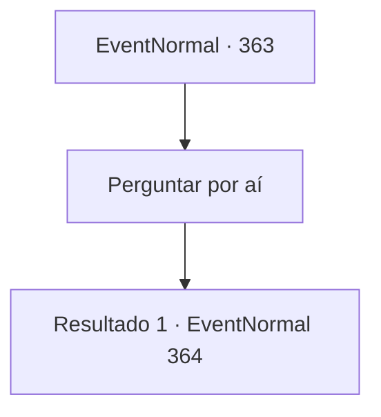

# Eventos normais · 363

[Índice da tabela](index.md) · [Índice geral](../index.md)

ID: `pt:EventNormal:363` · Fonte: `EventNormal4` · Versão: 1.2.47.

Mapeamento estático dos arquivos; a disponibilidade e a execução dependem do estado da run.

## Texto do evento

Com o pedido da dançarina em mente, você chega a 'Kargo'. Assim que você chega, você confere a carta que recebeu dela, indo para o lugar que a irmã dela morava. É uma casa construída com tijolos claros, com um jardim pequeno mas bem cuidado. Aqui e ali você vê traços de interação humana, mas não vê ninguém agora.

## Dados de entrada

```json
{
  "id": 363,
  "grade": 2,
  "place": "",
  "required": "5_236_1"
}
```

## Mapa das escolhas



## Escolhas e resultados

### Escolha 1

Perguntar por aí

Requisitos e outros campos da escolha:

```json
{
  "required": ""
}
```

#### Resultado 1.1

Você pega o retrato do homem que a dançarina pintou e pergunta aos moradores onde ele pode ser encontrado. Aparentemente, ele é bem conhecido neste lugar. Você é capaz de descobrir onde ele mora em breve, e o homem o cumprimenta com um sorriso caloroso. 

 "Ah, um aventureiro. Como posso ajudá-lo?"

 Parece que ele está dando comida para algumas pessoas famintas.

Continuação registrada: [Evento 364](0364.md) na mesma tabela.

```json
{
  "required": "",
  "chance": "1",
  "nextEvent": 364,
  "type": 2,
  "reward": ""
}
```

## Referências que chegam a este evento

Nenhum `nextEvent` positivo da mesma tabela aponta para este nó. Isso não prova que seja inacessível: sorteio e estado de história podem selecioná-lo.

