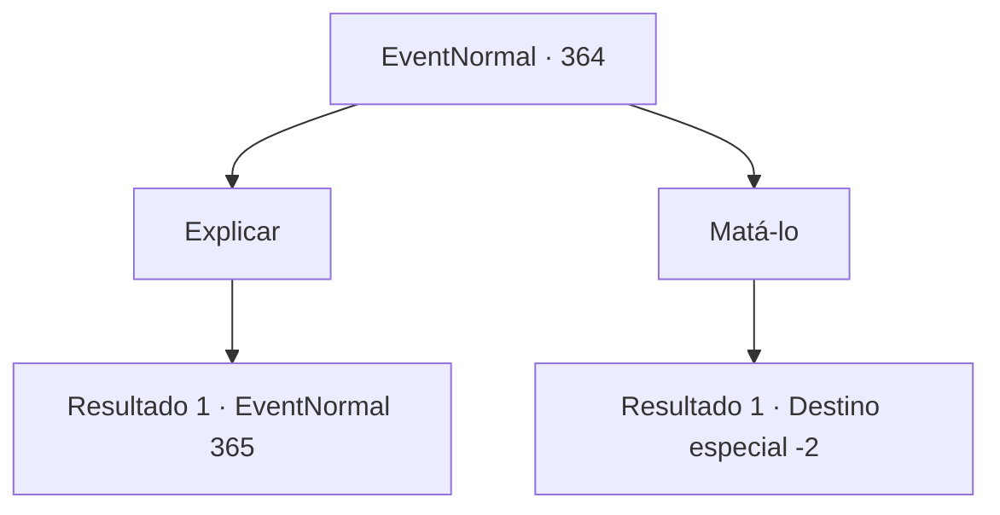

# Eventos normais · 364

[Índice da tabela](index.md) · [Índice geral](../index.md)

ID: `pt:EventNormal:364` · Fonte: `EventNormal4` · Versão: 1.2.47.

Mapeamento estático dos arquivos; a disponibilidade e a execução dependem do estado da run.

## Texto do evento

*Sem texto no arquivo.*

## Dados de entrada

```json
{
  "id": 364,
  "grade": 1,
  "place": "",
  "required": ""
}
```

## Mapa das escolhas



## Escolhas e resultados

### Escolha 1

Explicar

Requisitos e outros campos da escolha:

```json
{
  "required": ""
}
```

#### Resultado 1.1

Você vai para a abordagem honesta, dizendo a ele como o dançarino está convencido de que ele é um assassino. Ele ouve você em silêncio, e logo acena com um rosto triste. 

 "Eu não tinha ideia... você poderia esperar alguns minutos?"

 Quando você acena com a cabeça, ele compartilha a comida que estava segurando com as pessoas famintas, e leva você a uma pequena clareira próxima. Lá ele começa sua história. Uma história sobre como ele conheceu sua esposa como aventureiro e se estabeleceu em Kargo, como a forte fé do casal os levou a iniciar uma campanha de caridade nos bairros pobres e como sua esposa pegou uma praga e murchou. Depois de terminar, ele solta um suspiro curto. 

 "Eu simplesmente não podia contar a verdade para minha cunhada. Eu sou parcialmente responsável por sua morte, para dizer o mínimo."

 Ele olha para você calmamente com olhos tranquilos.

Continuação registrada: [Evento 365](0365.md) na mesma tabela.

```json
{
  "required": "",
  "chance": "1",
  "nextEvent": 365,
  "type": 2,
  "reward": ""
}
```

### Escolha 2

Matá-lo

Requisitos e outros campos da escolha:

```json
{
  "required": "2_3_-15"
}
```

#### Resultado 2.1

Apesar de seu sorriso caloroso, você o ataca primeiro. O ataque repentino o pega desprevenido e ele cai sangrando. <link=shake>

 "E..Eeek!!"

</link> As pessoas ao redor começam a gritar de agonia e você sai rapidamente da cidade. Você então rasga a carta da dançarina em pedaços.

Continuação registrada: [Destino especial `-2`](../destinos-especiais.md).

```json
{
  "required": "",
  "chance": "1",
  "nextEvent": -2,
  "type": 2,
  "reward": "4_223_1|5_236_3|0_3_-4"
}
```

## Referências que chegam a este evento

- [Evento 363 · escolha 1 · resultado 1](0363.md#escolha-1)
