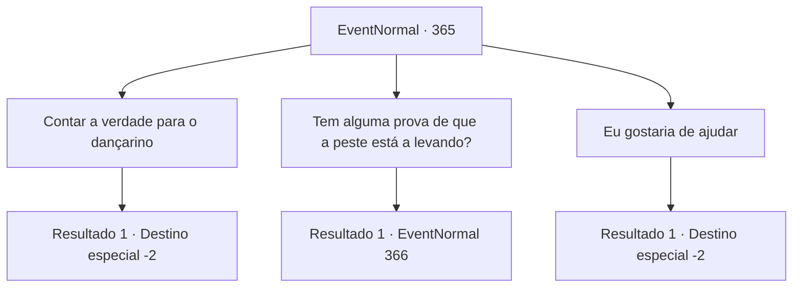

# Eventos normais · 365

[Índice da tabela](index.md) · [Índice geral](../index.md)

ID: `pt:EventNormal:365` · Fonte: `EventNormal4` · Versão: 1.2.47.

Mapeamento estático dos arquivos; a disponibilidade e a execução dependem do estado da run.

## Texto do evento

*Sem texto no arquivo.*

## Dados de entrada

```json
{
  "id": 365,
  "grade": 1,
  "place": "",
  "required": ""
}
```

## Mapa das escolhas



## Escolhas e resultados

### Escolha 1

Contar a verdade para o dançarino

Requisitos e outros campos da escolha:

```json
{
  "required": ""
}
```

#### Resultado 1.1

Você decide confiar nele. Quando você está prestes a sair, ele pede que você diga a sua cunhada o quanto ele está arrependido. Você acena para ele e sai da cidade.

Continuação registrada: [Destino especial `-2`](../destinos-especiais.md).

```json
{
  "required": "",
  "chance": "1",
  "nextEvent": -2,
  "type": 2,
  "reward": "4_223_1|5_236_2"
}
```

### Escolha 2

Tem alguma prova de que a peste está a levando?

Requisitos e outros campos da escolha:

```json
{
  "required": ""
}
```

#### Resultado 2.1

Você o questiona mais, perguntando se há evidências de sua esposa realmente morrendo de peste. Ele então aponta para o templo da cidade, respondendo. 

 "Nós cremamos o corpo dela lá. Deve haver registros escritos, você pode verificar lá se desejar."

 Vocês dois vão para o templo. A poucos passos do edifício principal, você vê um cemitério para homenagear os mortos. Cada lápide tem registros detalhados do falecido, de como, por que, quando eles morreram. 

 "Aqui. Da minha esposa."

 Uma lápide modesta, com a inscrição 'Arina. Pegou uma praga enquanto cuidava dos doentes, descanse em paz aqui.'. Você encontra o túmulo dela coberto de flores, provavelmente das pessoas que ela ajudou.

Continuação registrada: [Evento 366](0366.md) na mesma tabela.

```json
{
  "required": "",
  "chance": "1",
  "nextEvent": 366,
  "type": 2,
  "reward": ""
}
```

### Escolha 3

Eu gostaria de ajudar

Requisitos e outros campos da escolha:

```json
{
  "required": "1_3_15"
}
```

#### Resultado 3.1

Depois de ouvir a história dele, você diz a ele que deseja ajudar também. Ele parece emocionado, enquanto olha para você e continua. 

 "É... é assim? Obrigado."

 Você o segue até a casa dele. Dentro, você vê sacos de farinha, todos os tipos de vegetais e uma fornalha. 

 "Eu tenho que fazer um pouco de pão para amanhã. Eu poderia usar sua ajuda."

 Você faz massa de pão de maneira inepta, e o homem assa sua massa na fornalha. O delicioso aroma de pão assado toca seu nariz. Depois de um tempo, quando seus pulsos começam a doer, o trabalho está terminado. Ele agradece a você por ajudar e lhe dá um pedaço de pão. 

 "Agradeço a ajuda. E para minha cunhada... diga a ela que sinto muito."

 Você sai da cidade com o pão.

Continuação registrada: [Destino especial `-2`](../destinos-especiais.md).

```json
{
  "required": "",
  "chance": "1",
  "nextEvent": -2,
  "type": 2,
  "reward": "4_223_1|5_236_2|3_224_1|0_3_3"
}
```

## Referências que chegam a este evento

- [Evento 364 · escolha 1 · resultado 1](0364.md#escolha-1)
