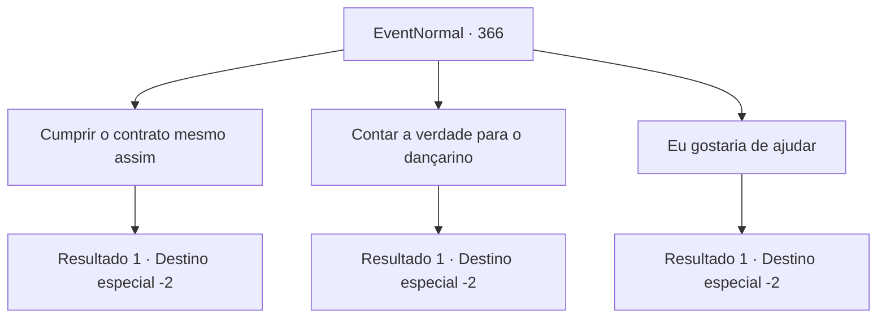

# Eventos normais · 366

[Índice da tabela](index.md) · [Índice geral](../index.md)

ID: `pt:EventNormal:366` · Fonte: `EventNormal4` · Versão: 1.2.47.

Mapeamento estático dos arquivos; a disponibilidade e a execução dependem do estado da run.

## Texto do evento

*Sem texto no arquivo.*

## Dados de entrada

```json
{
  "id": 366,
  "grade": 1,
  "place": "",
  "required": ""
}
```

## Mapa das escolhas



## Escolhas e resultados

### Escolha 1

Cumprir o contrato mesmo assim

Requisitos e outros campos da escolha:

```json
{
  "required": "2_3_-15"
}
```

#### Resultado 1.1

Você verifica o túmulo, mas o que importa não é a verdade. Sua missão é matar o homem, e é exatamente isso que você vai fazer. Você ataca o homem, e ele cai impotente, sangrando. 

 "A... ack...!"

 Com seus gritos persistentes em seus ouvidos, você sai rapidamente do cemitério. Você então rasga a carta da dançarina em pedaços.

Continuação registrada: [Destino especial `-2`](../destinos-especiais.md).

```json
{
  "required": "",
  "chance": "1",
  "nextEvent": -2,
  "type": 2,
  "reward": "4_223_1|5_236_3|0_3_-5"
}
```

### Escolha 2

Contar a verdade para o dançarino

Requisitos e outros campos da escolha:

```json
{
  "required": ""
}
```

#### Resultado 2.1

Você decide confiar nele. Quando você está prestes a sair, ele pede que você diga a sua cunhada o quanto ele está arrependido. Você acena para ele e sai da cidade.

Continuação registrada: [Destino especial `-2`](../destinos-especiais.md).

```json
{
  "required": "",
  "chance": "1",
  "nextEvent": -2,
  "type": 2,
  "reward": "4_223_1|5_236_2"
}
```

### Escolha 3

Eu gostaria de ajudar

Requisitos e outros campos da escolha:

```json
{
  "required": "1_3_15"
}
```

#### Resultado 3.1

Depois de ouvir a história dele, você diz a ele que deseja ajudar também. Ele parece emocionado, enquanto olha para você e continua. 

 "É... é assim? Obrigada."

 Você o segue até a casa dele. Dentro, você vê sacos de farinha, todos os tipos de vegetais e uma fornalha. 

 "Eu tenho que fazer um pouco de pão para amanhã. Eu poderia usar sua ajuda."

 Você faz massa de pão de maneira inepta, e o homem assa sua massa na fornalha. O delicioso aroma de pão assado toca seu nariz. Depois de um tempo, quando seus pulsos começam a doer, o trabalho está terminado. Ele agradece a você por ajudar e lhe dá um pedaço de pão. 

 "Agradeço a ajuda. E para minha cunhada... diga a ela que sinto muito."

 Você sai da cidade com o pão.

Continuação registrada: [Destino especial `-2`](../destinos-especiais.md).

```json
{
  "required": "",
  "chance": "1",
  "nextEvent": -2,
  "type": 2,
  "reward": "4_223_1|5_236_2|3_224_1|0_3_3"
}
```

## Referências que chegam a este evento

- [Evento 365 · escolha 2 · resultado 1](0365.md#escolha-2)
