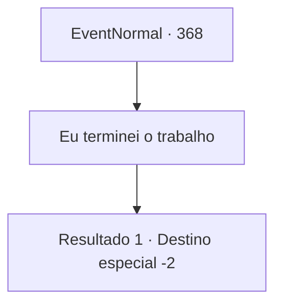

# Eventos normais · 368

[Índice da tabela](index.md) · [Índice geral](../index.md)

ID: `pt:EventNormal:368` · Fonte: `EventNormal4` · Versão: 1.2.47.

Mapeamento estático dos arquivos; a disponibilidade e a execução dependem do estado da run.

## Texto do evento

Você volta para a cidade onde conheceu a dançarina. Ela está dançando na praça da cidade, como da última vez. Quando sua performance chega ao fim, ela corre até você e pergunta como foi sua vingança.

## Dados de entrada

```json
{
  "id": 368,
  "grade": 2,
  "place": "",
  "required": "5_236_3"
}
```

## Mapa das escolhas



## Escolhas e resultados

### Escolha 1

Eu terminei o trabalho

Requisitos e outros campos da escolha:

```json
{
  "required": ""
}
```

#### Resultado 1.1

Você diz a ela que o homem foi cuidado. Ela solta um suspiro de alívio, explodindo em lágrimas. 

 "Obrigado... um milhão. Com certeza minha irmã estaria sorrindo...?"

 Ela diz para você ficar, corre para algum lugar e volta com um roupão de seda. 

 "Aqui, sua recompensa. Ganhei de presente, mas parece que você pode fazer melhor uso dele do que eu."

 Você pega a túnica da dançarina e se despede dela.

Continuação registrada: [Destino especial `-2`](../destinos-especiais.md).

```json
{
  "required": "",
  "chance": "1",
  "nextEvent": -2,
  "type": 2,
  "reward": "0_2_1|5_236_9|3_86_1"
}
```

## Referências que chegam a este evento

Nenhum `nextEvent` positivo da mesma tabela aponta para este nó. Isso não prova que seja inacessível: sorteio e estado de história podem selecioná-lo.

