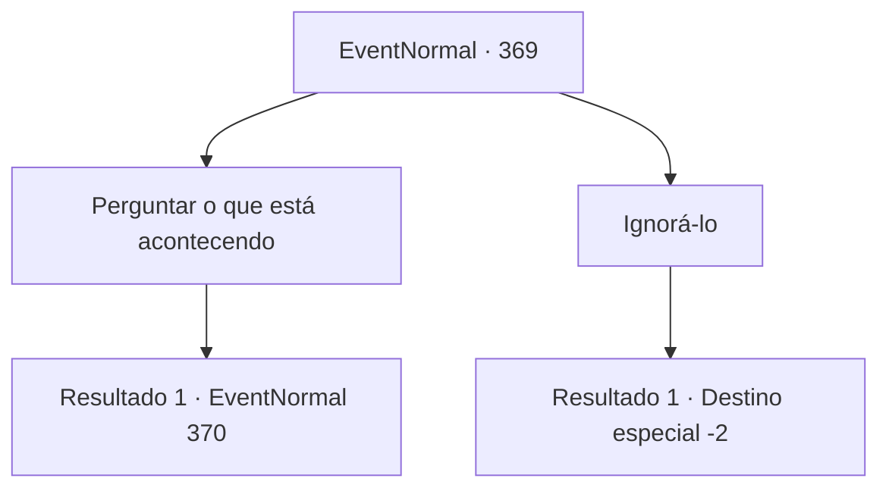

# Eventos normais · 369

[Índice da tabela](index.md) · [Índice geral](../index.md)

ID: `pt:EventNormal:369` · Fonte: `EventNormal4` · Versão: 1.2.47.

Mapeamento estático dos arquivos; a disponibilidade e a execução dependem do estado da run.

## Texto do evento

Chegando em uma pequena vila, você procura emprego para ganhar um pouco de dinheiro para sua aventura. Mas parece que todos os trabalhos já foram ocupados por outro aventureiro ou são tarefas fora de suas capacidades. Infelizmente, você decide aproveitar o tempo livre no pub, bebendo cerveja. Mas aí, você ouve um barulho lá fora. Ao sair para ver o que está acontecendo, você vê um aventureiro sangrando no chão. 

 "P-Por favor, salve meu companheiro...!"


## Dados de entrada

```json
{
  "id": 369,
  "grade": 1,
  "place": "",
  "required": "5_237_0"
}
```

## Mapa das escolhas



## Escolhas e resultados

### Escolha 1

Perguntar o que está acontecendo

Requisitos e outros campos da escolha:

```json
{
  "required": ""
}
```

#### Resultado 1.1

Ele está definitivamente em pânico. Você não pode realmente entender o que ele está dizendo. Em resumo, ele foi caçar na floresta com um de seus aliados, e encontrou um leão enquanto perseguiam um alce. Mas não era um leão comum, mas um amálgama de todos os tipos de animais. Ele e seu aliado foram derrotados imediatamente, e seu aliado foi levado pela fera. Você percebe que a besta de que ele está falando é uma manticora.

Continuação registrada: [Evento 370](0370.md) na mesma tabela.

```json
{
  "required": "",
  "chance": "1",
  "nextEvent": 370,
  "type": 2,
  "reward": ""
}
```

### Escolha 2

Ignorá-lo

Requisitos e outros campos da escolha:

```json
{
  "required": ""
}
```

#### Resultado 2.1

Você silenciosamente retorna ao seu lugar. Você bebe sua cerveja novamente. Algumas pessoas estão se voluntariando para ajudar o homem, mas você decide que está com as mãos ocupadas.

Continuação registrada: [Destino especial `-2`](../destinos-especiais.md).

```json
{
  "required": "",
  "chance": "1",
  "nextEvent": -2,
  "type": 2,
  "reward": "5_237_9"
}
```

## Referências que chegam a este evento

Nenhum `nextEvent` positivo da mesma tabela aponta para este nó. Isso não prova que seja inacessível: sorteio e estado de história podem selecioná-lo.

