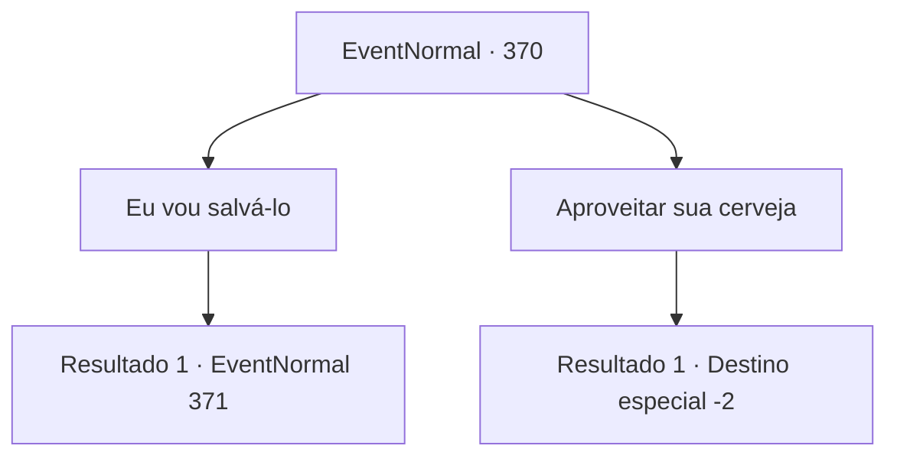

# Eventos normais · 370

[Índice da tabela](index.md) · [Índice geral](../index.md)

ID: `pt:EventNormal:370` · Fonte: `EventNormal4` · Versão: 1.2.47.

Mapeamento estático dos arquivos; a disponibilidade e a execução dependem do estado da run.

## Texto do evento

*Sem texto no arquivo.*

## Dados de entrada

```json
{
  "id": 370,
  "grade": 1,
  "place": "",
  "required": ""
}
```

## Mapa das escolhas



## Escolhas e resultados

### Escolha 1

Eu vou salvá-lo

Requisitos e outros campos da escolha:

```json
{
  "required": ""
}
```

#### Resultado 1.1

Você diz a ele que vai ajudar. Depois de ouvir sobre onde o monstro está, você entra na floresta. A floresta em si não é tão difícil de viajar, mas o sol está começando a desaparecer.

Continuação registrada: [Evento 371](0371.md) na mesma tabela.

```json
{
  "required": "",
  "chance": "1",
  "nextEvent": 371,
  "type": 2,
  "reward": "5_237_9"
}
```

### Escolha 2

Aproveitar sua cerveja

Requisitos e outros campos da escolha:

```json
{
  "required": ""
}
```

#### Resultado 2.1

Você silenciosamente retorna ao seu lugar. Você bebe sua cerveja novamente. Algumas pessoas estão se voluntariando para ajudar o homem, mas você decide que está com as mãos ocupadas.

Continuação registrada: [Destino especial `-2`](../destinos-especiais.md).

```json
{
  "required": "",
  "chance": "1",
  "nextEvent": -2,
  "type": 2,
  "reward": "5_237_9"
}
```

## Referências que chegam a este evento

- [Evento 369 · escolha 1 · resultado 1](0369.md#escolha-1)
