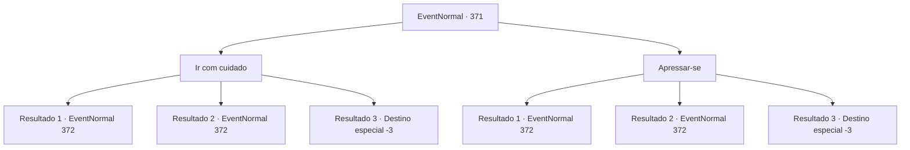

# Eventos normais · 371

[Índice da tabela](index.md) · [Índice geral](../index.md)

ID: `pt:EventNormal:371` · Fonte: `EventNormal4` · Versão: 1.2.47.

Mapeamento estático dos arquivos; a disponibilidade e a execução dependem do estado da run.

## Texto do evento

*Sem texto no arquivo.*

## Dados de entrada

```json
{
  "id": 371,
  "grade": 1,
  "place": "",
  "required": ""
}
```

## Mapa das escolhas



## Escolhas e resultados

### Escolha 1

Ir com cuidado

Requisitos e outros campos da escolha:

```json
{
  "required": ""
}
```

#### Resultado 1.1

A operação de resgate será muito mais difícil no escuro, mas você mantém a compostura, movendo-se com cuidado e não baixando a guarda. Logo, você percebe que sua decisão foi correta. Você encontra uma manticora, esperando nos arbustos para emboscar você. Ele descobre que você o viu e lentamente se revela dos arbustos. Sua boca está coberta com o que parece ser o sangue das vítimas.

Continuação registrada: [Evento 372](0372.md) na mesma tabela.

```json
{
  "required": "",
  "chance": "1|0_7_1",
  "nextEvent": 372,
  "type": 0,
  "reward": "6_0_96",
  "place": 1
}
```

#### Resultado 1.2

A operação de resgate será muito mais difícil no escuro, mas você mantém a compostura, movendo-se com cuidado e não baixando a guarda. Mas você é incapaz de sentir a emboscada da manticora. Suas garras afiadas rasgam sua carne e respingam sangue. Você recua alguns passos e levanta sua arma.

Continuação registrada: [Evento 372](0372.md) na mesma tabela.

```json
{
  "required": "1_0_2",
  "chance": "13",
  "nextEvent": 372,
  "type": 1,
  "reward": "6_0_96|0_0_-1",
  "place": 1
}
```

#### Resultado 1.3

A operação de resgate será muito mais difícil no escuro, mas você mantém a compostura, movendo-se com cuidado e não baixando a guarda. Mas você é incapaz de sentir a emboscada da manticora. Suas garras afiadas rasgam sua carne e respingam sangue. Você perde a consciência depois de testemunhar seu sangue.

Continuação registrada: [Destino especial `-3`](../destinos-especiais.md).

```json
{
  "required": "2_0_2",
  "chance": "13",
  "nextEvent": -3,
  "type": 1,
  "reward": "0_0_-1"
}
```

### Escolha 2

Apressar-se

Requisitos e outros campos da escolha:

```json
{
  "required": ""
}
```

#### Resultado 2.1

A operação de resgate será muito mais difícil no escuro, então você corre para o ninho da manticora. À medida que você se aproxima do ninho, uma manticora pula de cima à sua frente de um lugar alto. Você não seria capaz de ver suas sombras no escuro. Você rapidamente evita seu ataque e entra em combate.

Continuação registrada: [Evento 372](0372.md) na mesma tabela.

```json
{
  "required": "",
  "chance": "1|0_6_1",
  "nextEvent": 372,
  "type": 0,
  "reward": "6_0_96",
  "place": 1
}
```

#### Resultado 2.2

A operação de resgate será muito mais difícil no escuro, então você corre para o ninho da manticora. À medida que você se aproxima do ninho, uma manticora pula de cima à sua frente de um lugar alto. Mas você não consegue ver isso chegando, e isso atrai o primeiro sangue.

Continuação registrada: [Evento 372](0372.md) na mesma tabela.

```json
{
  "required": "1_0_2",
  "chance": "13",
  "nextEvent": 372,
  "type": 1,
  "reward": "6_0_96|0_0_-1",
  "place": 1
}
```

#### Resultado 2.3

A operação de resgate será muito mais difícil no escuro, então você corre para o ninho da manticora. À medida que você se aproxima do ninho, uma manticora pula de cima à sua frente de um lugar alto. Mas você não consegue ver isso chegando, e isso te deixa inconsciente com uma mordida no pescoço.

Continuação registrada: [Destino especial `-3`](../destinos-especiais.md).

```json
{
  "required": "2_0_2",
  "chance": "13",
  "nextEvent": -3,
  "type": 1,
  "reward": "0_0_-1"
}
```

## Referências que chegam a este evento

- [Evento 370 · escolha 1 · resultado 1](0370.md#escolha-1)
