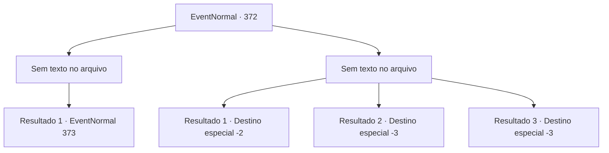

# Eventos normais · 372

[Índice da tabela](index.md) · [Índice geral](../index.md)

ID: `pt:EventNormal:372` · Fonte: `EventNormal4` · Versão: 1.2.47.

Mapeamento estático dos arquivos; a disponibilidade e a execução dependem do estado da run.

## Texto do evento

*Sem texto no arquivo.*

## Dados de entrada

```json
{
  "id": 372,
  "grade": 1,
  "place": "",
  "required": ""
}
```

## Mapa das escolhas



## Escolhas e resultados

### Escolha 1

*Sem texto no arquivo; o papel dessa opção depende da interface do jogo.*

Requisitos e outros campos da escolha:

```json
{
  "required": ""
}
```

#### Resultado 1.1

A manticora é uma criatura poderosa, mas não é páreo para você. Ao observar seu cadáver, você encontra um pano rasgado preso em seus dentes. Você se sente confiante de que esta manticora é o que atacou os aventureiros da vila. Você remove uma de suas presas como um símbolo de derrotá-lo e volta para seu ninho. Logo, você chega ao ninho da manticora, localizado no topo de um penhasco. Mas, infelizmente, o que o recebe é o corpo de um aventureiro morto.

Continuação registrada: [Evento 373](0373.md) na mesma tabela.

```json
{
  "required": "",
  "chance": "1",
  "nextEvent": 373,
  "type": 2,
  "reward": ""
}
```

### Escolha 2

*Sem texto no arquivo; o papel dessa opção depende da interface do jogo.*

Requisitos e outros campos da escolha:

```json
{
  "required": ""
}
```

#### Resultado 2.1

Você luta desesperadamente contra a manticora, mas suas asas, couro de ferro e presas e garras afiadas levam a melhor sobre você. Incapaz de derrubar a fera, você aproveita a oportunidade para fugir. A manticora não te persegue mais. Aparentemente não está com fome no momento. De volta à vila, você traz a má notícia de não conseguir resgatar o aventureiro. A trágica notícia rouba-lhes a esperança, e você não pode evitar seus olhares.

Continuação registrada: [Destino especial `-2`](../destinos-especiais.md).

```json
{
  "required": "1_0_2|1_1_2",
  "chance": "1",
  "nextEvent": -2,
  "type": 2,
  "reward": "0_0_-1|0_1_-1"
}
```

#### Resultado 2.2

Você luta desesperadamente contra a manticora, mas suas asas, couro de ferro e presas e garras afiadas levam a melhor sobre você. Infelizmente, com o corpo maciço da fera pressionando você, você sente o mundo escurecer com uma dor excruciante quando sua mandíbula se conecta ao seu pescoço.

Continuação registrada: [Destino especial `-3`](../destinos-especiais.md).

```json
{
  "required": "2_0_2",
  "chance": "1",
  "nextEvent": -3,
  "type": 2,
  "reward": "0_0_-1|0_1_-1"
}
```

#### Resultado 2.3

Você luta desesperadamente contra a manticora, mas suas asas, couro de ferro e presas e garras afiadas levam a melhor sobre você. Infelizmente, com o corpo maciço da fera pressionando você, você sente o mundo escurecer com uma dor excruciante quando sua mandíbula se conecta ao seu pescoço.

Continuação registrada: [Destino especial `-3`](../destinos-especiais.md).

```json
{
  "required": "2_1_2",
  "chance": "1",
  "nextEvent": -3,
  "type": 2,
  "reward": "0_0_-1|0_1_-1"
}
```

## Referências que chegam a este evento

- [Evento 371 · escolha 1 · resultado 1](0371.md#escolha-1)
- [Evento 371 · escolha 1 · resultado 2](0371.md#escolha-1)
- [Evento 371 · escolha 2 · resultado 1](0371.md#escolha-2)
- [Evento 371 · escolha 2 · resultado 2](0371.md#escolha-2)
